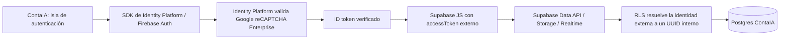

# Diseño de arquitectura: Google reCAPTCHA como único CAPTCHA de Auth

**Estado:** diseño técnico; no se ha modificado código ni configuración de servicios.

## Arquitectura recomendada

La ruta más directa para que Google reCAPTCHA sea el control efectivo en registro, inicio de sesión y recuperación es usar **Google Cloud Identity Platform como proveedor primario de identidad**, con su integración nativa de reCAPTCHA Enterprise. ContaIA conservaría Supabase para Postgres, Storage, Realtime y Data API, pero la isla de autenticación dejaría de crear sesiones con Supabase Auth y usaría el SDK de Identity Platform/Firebase Auth.

El control no quedaría en un widget del navegador ni en una ruta Vercel que luego llame a Supabase. Identity Platform genera las evaluaciones de reCAPTCHA y puede rechazar las operaciones que no incluyan el token exigido. La documentación de Google define los modos de auditoría y aplicación; además, el endpoint de inicio de sesión con correo y contraseña exige `captchaResponse` cuando reCAPTCHA Enterprise está habilitado [1] [2].

Identity Platform gestiona sus propias claves de reCAPTCHA Enterprise y las carga desde el SDK. Por eso, la arquitectura no debe asumir que utilizará la site key pública que se compartió antes. Si esa clave específica debe ser obligatoria, habrá que comprobar su tipo y proyecto por separado; el uso de una integración manual no debe confundirse con la protección nativa de Identity Platform [1] [3].

## Comparación de alternativas

### 1. Google Identity Platform con integración nativa — recomendada para validar

Google documenta la protección de alta por correo y contraseña y de recuperación; el endpoint `accounts:signInWithPassword` confirma que el token CAPTCHA se exige también en el inicio de sesión con contraseña cuando la protección Enterprise está activa. El SDK web obtiene la configuración de reCAPTCHA y genera la señal para las operaciones configuradas. El despliegue ofrece modos de auditoría y aplicación, útiles para probar antes de bloquear tráfico real [1] [2].

Supabase documenta Firebase Auth como proveedor externo: su cliente puede adjuntar el ID token de Firebase mediante `accessToken`, y Supabase puede validar ese token para acceder a Data API, Storage y Realtime. Se requiere incluir el claim `role: authenticated`. Google Identity Platform usa la infraestructura Firebase Auth, por lo que la integración debe probarse en un proyecto de ensayo antes de migrar usuarios [4] [5].

Esta opción conserva la base de datos y reduce el riesgo de construir un verificador de CAPTCHA propio. No es un cambio pequeño: ContaIA hoy usa sesiones de Supabase Auth y varias tablas dependen de sus UUID. También se deben revisar los costos de Identity Platform, reCAPTCHA Enterprise y la cuota de usuarios externos de Supabase antes de aprobarla [1] [5].

### 2. Auth0 con Bot Detection y Google reCAPTCHA Enterprise

Auth0 documenta CAPTCHA para flujos de contraseña, registro y recuperación. Permite requerirlo siempre o solo ante riesgo y ofrece soporte completo para Universal Login. Supabase también documenta el uso del ID token de Auth0 como token externo, con el claim `role: authenticated` [6] [7].

La integración documentada de Auth0 con Google reCAPTCHA Enterprise está dirigida a tráfico superior a un millón de evaluaciones al mes. Además, el procedimiento requiere una clave para el dominio del tenant Auth0 y un reto de casilla. Por tanto, no debe asumirse que la site key recibida se puede reutilizar ni que la opción sea económicamente apropiada para el volumen actual de ContaIA. Universal Login también implica cambiar la experiencia visual y validar de nuevo el acceso mediante alias [6] [7].

### 3. Verificar reCAPTCHA en Vercel y llamar a Supabase Auth

Esta alternativa se descarta. Supabase Auth no documenta Google como proveedor CAPTCHA nativo. Una verificación en Vercel no impediría que un cliente externo invoque directamente los endpoints públicos de Supabase Auth. Cambiar el widget del frontend o esconder las llamadas no demostraría que la verificación es obligatoria. No debe retirarse la protección nativa actual mientras ese endpoint pueda aceptar las mismas operaciones sin una validación equivalente [8] [9].

## Integración propuesta con los datos actuales

El cliente de autenticación usaría Firebase Auth para registro, login, sesión, cierre de sesión y recuperación. El cliente de Supabase recibiría el ID token de Identity Platform mediante su opción `accessToken`; el token debe contener `role: authenticated`, asignado mediante un proceso administrativo, no desde datos editables por el usuario [4]. El correo de confirmación, la recuperación y los destinos `?destino=` se conservarían con URLs y plantillas verificadas para ContaIA.

La migración de identidad y RLS es el principal trabajo de datos. El repositorio tiene tablas y políticas enlazadas a `auth.users.id` y `auth.uid()`, por ejemplo `learning_progress`, `fiscal_profiles`, `auth_usernames` y `cfdi_analysis_runs`. Un token externo no debe tratarse como si creara automáticamente un usuario Supabase con el mismo UUID. Antes de mover datos se debe probar el comportamiento real del JWT y diseñar un identificador interno estable.

La propuesta es crear un registro de usuario de aplicación con UUID estable y un mapa privado entre `(issuer, subject)` del token verificado y ese UUID. Se migrarían a ese identificador las claves foráneas que hoy dependen de `auth.users`; las políticas RLS usarían una función controlada que resuelva el usuario interno a partir del token validado. Los UUID actuales se conservarían durante el backfill para no reasignar la propiedad de datos. Las tablas, defaults y políticas que usan `auth.uid()` tendrían pruebas de acceso por propietario antes y después de la migración [5] [8].

El acceso por alias requiere una decisión explícita. El inicio de sesión estándar de Identity Platform usa correo y contraseña; no hereda automáticamente el resolvedor actual de ContaIA. Se debe prototipar una resolución segura de alias que no revele si existe una cuenta y que mantenga la verificación de Google exigida por Identity Platform. Si eso no puede demostrarse con el SDK/API admitidos, la alternativa simple es pasar a correo como identificador de login; no se debe improvisar un flujo que emita tokens por fuera del control de reCAPTCHA.

También hay que probar cómo se bloquean las rutas de email/password de Supabase Auth después del cambio. Supabase indica que su servicio Auth no se puede desactivar por completo, aunque permite usar proveedores externos de forma independiente. Antes de declarar Google como único CAPTCHA, un entorno de ensayo debe demostrar que las rutas antiguas de Auth no permiten registro, login o recuperación sin Google, mientras los JWT externos siguen funcionando en las APIs de datos. Si no se pueden cerrar esas rutas, la migración no cumple el requisito de CAPTCHA único y no se debe publicar [5].

## Fases y criterios de aceptación

1. **Prueba aislada de Identity Platform.** En un proyecto de desarrollo, activar email/password y reCAPTCHA en modo auditoría. Probar alta, login y recuperación con el SDK web. Luego, en ese entorno, pasar a enforcement y comprobar que una llamada sin token válido falla. No tocar la configuración de producción.
2. **Prueba Supabase third-party y RLS.** Conectar un token Firebase/Identity Platform a Supabase y verificar el claim `role`. Crear un usuario de prueba, mapearlo a un UUID interno y comprobar lecturas/escrituras propias y denegación de datos ajenos. Probar también Storage y Realtime si se usan en rutas con datos privados.
3. **Prueba de compatibilidad de cuentas y alias.** Confirmar cómo se importan las cuentas existentes, qué ocurre con contraseñas y correo confirmado, y cómo se resuelve el alias. Si no se puede portar de forma verificada el hash de contraseña, definir un proceso de restablecimiento o migración gradual antes de mover usuarios reales.
4. **Plan de corte reversible.** Solo tras aprobar las pruebas, diseñar el cambio de la isla de Auth, migrar RLS/foreign keys y bloquear la autenticación local antigua. Mantener el mecanismo de rollback hasta confirmar sesiones, confirmaciones de correo, recuperación, alias y acceso a datos. Esta fase requiere autorización separada antes de implementar.

La arquitectura se acepta únicamente si registro, login y recuperación rechazan solicitudes sin evaluación Google válida; los endpoints antiguos no ofrecen una vía alternativa; la identidad interna no cambia la propiedad de los datos; y la matriz E2E demuestra aislamiento entre dos usuarios. No se eliminarán referencias ni configuración de los proveedores actuales antes de validar el corte y su rollback.

## Referencias

[1]: https://docs.cloud.google.com/identity-platform/docs/recaptcha-enterprise "Google Identity Platform reCAPTCHA Enterprise integration"
[2]: https://docs.cloud.google.com/identity-platform/docs/reference/rest/v1/accounts/signInWithPassword "Google Identity Platform sign in with password REST reference"
[3]: https://docs.cloud.google.com/recaptcha/docs/create-key-website?hl=es-419 "Google reCAPTCHA website keys"
[4]: https://supabase.com/docs/guides/auth/third-party/firebase-auth "Supabase Firebase Auth third-party integration"
[5]: https://supabase.com/docs/guides/auth/third-party/overview "Supabase third-party auth overview"
[6]: https://auth0.com/docs/secure/attack-protection/bot-detection/configure-captcha "Auth0 third-party CAPTCHA provider integrations"
[7]: https://auth0.com/docs/secure/attack-protection/bot-detection "Auth0 Bot Detection"
[8]: https://supabase.com/docs/guides/database/postgres/row-level-security "Supabase Row Level Security"
[9]: https://supabase.com/docs/guides/auth/auth-captcha "Supabase Enable CAPTCHA Protection"
