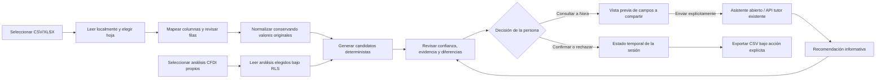

# Plan de implementación — evolución visual modular de ContaIA

**Estado:** aprobado por el usuario para implementar localmente las fases 0–4. No se autorizaron commit, push, despliegue, cambios de backend ni nuevas operaciones fiscales.

## Objetivo

Evolucionar ContaIA hacia un centro coherente de aprendizaje y control fiscal que combine claridad profesional, motivación educativa y acompañamiento contextual de Nora. La primera iteración rediseñará el centro de Herramientas, establecerá una estructura común para sus espacios y usará el importador CFDI como referencia real, **sin cambiar las capacidades, reglas, persistencia, APIs ni transmisión de datos existentes**.

La interfaz distinguirá lo que ya funciona de lo que está en preparación: ninguna herramienta se presentará como operativa, integrada o conectada si la aplicación no puede respaldar esa afirmación con datos reales.

## Estado actual y condicionantes del proyecto

La aplicación es una SPA servida desde `public/index.html`; `src/main.js` elige Aula, Laboratorio, Herramientas, CFDI, Estudio o Nora mediante `state.section`. El Aula y otras vistas internas no requieren nuevas rutas públicas para esta iteración. El build estático copia el sitio a `dist/` desde `scripts/build-site.js`; `vercel.json` ya configura la publicación y las rutas públicas.

La vista real del centro de herramientas se construye en `src/tools/panel.js` y usa `src/tools/workspace.js`, `client.js` y `server.js`. Existe también `src/tools/ToolsPanel.jsx` con catálogo paralelo; antes de ampliar la interfaz se debe evitar que ambos catálogos diverjan y conservar como punto de partida el renderer que realmente monta `src/main.js`, sin reescribir la SPA a React.

Herramientas ya permite gestionar perfiles fiscales y registrar conexiones por herramienta y ambiente; registrar una conexión no configura ni verifica por sí solo un proveedor. La API acepta alertas y vencimientos, pero la UI no muestra aún un monitor alimentado por datos visibles. CFDI sí tiene capacidades reales: importación local XML/ZIP, revisión previa de lotes, análisis y relaciones entre comprobantes, resultados, alertas, historial opcional en Supabase y transferencia explícita de un resumen acotado a Nora. Contabilidad, Nómina y DIOT están en preparación o son informativas: no hay evidencia de modelos operativos de movimientos/conciliación, cálculos de nómina o declaraciones DIOT. Documentos dispone de piezas de lectura/carga en el asistente, pero no equivale todavía a una biblioteca fiscal completa.

El progreso de curso y ejercicios se conserva localmente y separado de los datos fiscales. No se observó un modelo de insignias, objetivos semanales o actividad operativa transversal. Las tablas actuales de `fiscal_profiles`, `tool_connections`, `fiscal_alerts` y `fiscal_deadlines` no deben interpretarse como prueba de una integración activa o de una operación fiscal completada.

## Alcance propuesto

### Primera iteración

1. Rediseñar la pantalla principal de **Herramientas** como hub profesional y responsive, con perfil/contexto, actividad real disponible, pendientes/alertas existentes y tarjetas con acción principal clara.
2. Definir una plantilla visual compartida para las herramientas, reutilizable sin sustituir sus controladores ni cambiar sus contratos: encabezado con nombre, descripción, estado y acción primaria; resumen; área de trabajo; resultados/historial cuando existan; ayuda contextual de Nora; siguiente paso y enlace a Aula/Base de estudio.
3. Adaptar **CFDI** como demostración del patrón usando su flujo actual: carga y revisión previa, análisis local, hallazgos, resultados, historial y envío explícito del resumen a Nora. Añadir enlaces de continuidad educativa solo si pueden llevar a módulos/prácticas existentes.
4. Llevar la nueva paleta a Herramientas y al marco compartido de la primera iteración, manteniendo accesibilidad, privacidad y estados textuales además de color.
5. Integrar el diseño mobile-first en las mismas vistas, respetando la navegación interna y las acciones actuales.

### Posterior, sujeto al resultado y a nueva aprobación de alcance

- Metas semanales e insignias sincronizadas requieren definir primero eventos, reglas y persistencia; no se inventarán métricas.
- Ampliación de los espacios de Contabilidad, Nómina, DIOT, Monitor fiscal, Perfil, Conexiones y Documentos según datos y operaciones que efectivamente existan. La creación de cálculos, conciliaciones, presentación/declaración, alertas automáticas, almacenamiento documental, nuevas tablas o integraciones se considera trabajo funcional/backend independiente y requerirá autorización específica.
- Modo oscuro para análisis/IA como decisión opcional posterior; no se impondrá un tema global en la primera iteración.

## Arquitectura y estructura del proyecto

- `public/index.html`, `public/manus-routes.json`: shell público y manifiesto de rutas. La iteración inicial no añade rutas públicas; las secciones internas siguen usando `state.section`.
- `src/main.js`: composición de vistas y navegación actual. Se mantiene como punto de entrada; solo se ajusta la composición visual necesaria para insertar el marco común sin alterar eventos ni sesiones.
- `src/styles.css`: tokens globales y estilos del shell; se añadirán tokens semánticos nuevos con alcance controlado, conservando alias y temas heredados durante la transición.
- `src/tools/panel.js`: renderer activo del hub y de sus tarjetas. Será la base para la jerarquía nueva y el catálogo unificado.
- `src/tools/ToolsPanel.jsx`: componente/catálogo paralelo. Se verificará su uso real y se evitará mantener dos definiciones incompatibles; no se hará una migración de framework como parte del plan.
- `src/tools/workspace.js`, `client.js`, `server.js`: estado/eventos del espacio, acceso a API y contratos existentes de perfiles, conexiones, alertas y fechas. Se conservan sus contratos; el marco visual consume los datos disponibles y respeta sus estados vacíos.
- `src/cfdi/workspace.js`, `parser.js`, `analysis.js`, `relations.js`, `upload-queue.js`, `cfdi.css`: importador y análisis CFDI. Se conserva su lógica; la adaptación visual reutiliza la cola de revisión publicada y el handoff explícito a Nora.
- `src/course.js`, `classroom.js`, `exercises.js`, `progress.js`, `glossary.js`, `study-db.js`: módulos, prácticas, conocimiento y progreso educativo local. Son la fuente para enlaces y progreso de aprendizaje, no para métricas fiscales.
- `src/tutor/*`: contexto, chat/streaming, documentos, voz y sesión opcional de Anam. Nora se contextualiza con los datos ya autorizados por cada flujo; Anam, micrófono y envío de documentos no se activan automáticamente.
- `src/auth/*`, `src/documents/*`, `scripts/build-site.js`, `server.js`, `vercel.json`, `tests/*`: autenticación, funciones documentales, build/serving y pruebas existentes. Se mantienen los contratos de publicación y los controles de privacidad.

Se propone añadir un pequeño módulo de **metadatos semánticos de herramientas** y un renderer puro del marco común (por ejemplo, bajo `src/tools/`). El registro separará: (a) madurez/disponibilidad del módulo —operativo, requiere conexión o en preparación— y (b) estado de conexión —sin configurar, pendiente, conectada, requiere revisión o error—. El renderer recibirá datos ya obtenidos por los controladores actuales; no hará llamadas de red ni mutará estado. Las etiquetas, descripciones y CTAs por herramienta se centralizarán para que panel, shell e indicadores compartan una única fuente de verdad.

## Dirección de diseño

- **Movimiento:** editorial fiscal contemporáneo; combina lectura de archivo contable, precisión de una herramienta financiera y calidez de un aula acompañada.
- **Principios:** primero claridad y confianza; una acción primaria por vista; estados verificables y legibles; aprendizaje integrado sin interrumpir el trabajo.
- **Filosofía de color:** el azul petróleo `#123B43` estructura navegación, encabezados y análisis; el jade `#16866F` señala acciones y progreso positivo; el marfil `#F5F4EC` sostiene lectura; la arena `#E4E6D8` agrupa información secundaria; el coral `#E98268` reserva atención a pendientes/riesgos; el amarillo `#D9B84C` destaca recomendaciones y logros. Los significados se acompañan siempre de texto, icono y contraste, no solo color.
- **Convivencia con la marca actual:** la paleta nueva se introduce primero en Herramientas, shell y CFDI mediante tokens y límites de tema. `brand-spec.md` reserva actualmente la lavanda/menta oscura al Aula en vivo y AuditPro a CFDI; la primera iteración no sobrescribirá `:root` ni cambiará globalmente el Aula/login. Una extensión de la paleta al Aula o un modo oscuro nuevo se decidirán después de revisar la primera entrega.
- **Paradigma de layout:** escritorio con encabezado breve, franja de resumen y espacio de trabajo centrado en la tarea, acompañado por un carril contextual lateral; las tarjetas se usan para elegir herramientas, no como patrón para todas las pantallas. En móvil, contenido apilado, CTA principal visible, áreas táctiles amplias y navegación inferior de cinco destinos —Inicio, Curso, Estudio, Herramientas y Nora— mapeados a vistas/handlers existentes, sin ocultar estados ni cambiar flujos funcionales.
- **Motivos distintivos:** reglas finas de hoja contable en superficies seleccionadas; sello discreto para revisión/validación; nodos conectados para una ruta de aprendizaje; iconos funcionales de factura, calculadora y carpeta en herramientas relacionadas. Reutilizar los cuatro avatares locales de Nora para los estados listo, explicando, pensando y celebrando cuando correspondan a una acción real. Texturas/grano y símbolos fiscales se limitan a hero, login y estados vacíos para no competir con tablas y documentos.
- **Interacción:** la pantalla responde a “qué herramienta es”, “qué requiere atención”, “qué hago ahora” y “qué resultado obtuve”. Acciones son explícitas; estados de error/revisión tienen explicación y recuperación; Nora ofrece ayuda contextual sin abrir sesiones o enviar contenido por su cuenta.
- **Animación:** transiciones breves y funcionales (aprox. 150–220 ms), confirmación de estado y progreso al completar acciones reales; evitar movimiento decorativo continuo. Respetar `prefers-reduced-motion`, teclado y foco visible; no desmontar el nodo de vídeo/WebRTC de Anam durante rerenderizados.
- **Tipografía:** mantener Alegreya Sans para interfaz/lectura y DM Mono para datos compactos/etiquetas, según `brand-spec.md`; reforzar jerarquía con tamaños, interlineado y espacios en múltiplos de 4 px, radios discretos y sombras moderadas.
- **Esencia de marca:** “Un centro fiscal para aprender, practicar y actuar con contexto”; personalidad confiable, clara y didáctica.
- **Voz:** directa, serena y basada en evidencia. Ejemplos: “Revisa estos hallazgos antes de continuar.” / “El XML permanece en tu dispositivo; analiza el lote cuando esté listo.”
- **Marca y logotipo:** conservar el wordmark/marca existente y `public/favicon.svg`; no rediseñar el logo en esta iteración. Usar las reglas de hoja y el sello de validación como recursos de interfaz, no como sustitutos de la marca.
- **Color insignia:** azul petróleo `#123B43`, combinado con el jade como color de acción.

## Secuencia de implementación

### Fase 0 — Acordar base visual y semántica

Introducir tokens de la paleta «Confianza fiscal» con nombres por rol y alcance explícito. Definir los estados de herramienta y conexión como conceptos distintos; mapear el catálogo actual y sus acciones a esos conceptos. Resolver la fuente única del catálogo sin reescribir el framework. Esta fase prepara la pantalla sin cambiar las respuestas ni llamadas de API.

### Fase 1 — Centro principal de Herramientas

Reorganizar `renderToolsPanel()` en torno a prioridades y acciones: perfil fiscal y estado, señales de actividad con datos presentes, luego herramientas agrupadas por objetivo y disponibilidad. Mostrar explícitamente conexión no configurada, pendiente, conectada, revisión/error y preparación del módulo, con texto y acciones pertinentes. Si alertas, fechas o actividad están vacías, mostrar un estado vacío útil en lugar de contadores o registros ficticios. Adaptar jerarquía y navegación a móvil sin retirar accesos actuales.

### Fase 2 — Marco compartido de herramienta

Crear el shell de presentación reutilizable y delgado. La metadata define título, descripción, estado de disponibilidad, acción primaria y contexto; cada controlador existente sigue siendo dueño de su estado, permisos y peticiones. Implementar primero el shell con los espacios y capacidades que ya existen: Perfil fiscal, Conexiones y CFDI. Las herramientas en preparación conservarán mensajes honestos y no recibirán formularios operativos ficticios.

### Fase 3 — CFDI como demostración

Integrar el workspace existente dentro del shell, alineando encabezado, resumen, revisión del lote, resultados/hallazgos, historial y acciones posteriores. Mantener el límite de privacidad, procesamiento local y comportamiento de la cola. El panel de Nora puede explicar el resumen solo mediante la acción explícita ya existente; enlaces de estudio conducirán a módulos o prácticas reales. No se convierte el CFDI en validación SAT ni se cambia almacenamiento/API.

### Fase 4 — Continuidad educativa y Nora contextual

Tras estabilizar el primer flujo, añadir una tarjeta de “Continúa donde lo dejaste”, progreso y ruta usando solo módulos y prácticas ya registrados. Nora cambia su texto/ayuda según la herramienta y los datos disponibles, sin personalización inventada ni transferencia automática. Las metas semanales, insignias persistentes y gráficas operativas se dejan fuera hasta definir fuentes, reglas y persistencia.

### Fase 5 — Extensión gradual y decisión de marca

Ajustar las demás tarjetas y vistas al lenguaje visual común en el grado que permita su funcionalidad actual. Mantener Contabilidad/Nómina/DIOT/Monitor como preparación mientras no existan flujos respaldados. Separar futuras mejoras de backend por dominio y solicitar autorización específica antes de añadir operaciones fiscales, sincronizaciones o almacenamiento nuevo. Revisar entonces si la paleta debe extenderse al Aula oscura y si conviene un modo oscuro adicional.

## Dependencias y límites materiales

La primera iteración utiliza JavaScript/CSS existentes y los datos/API actuales; no requiere nuevas dependencias ni reescritura del enrutador. El build continúa produciendo `dist/` y Vercel sigue sirviendo el mismo sitio y endpoints. El contenido fiscal se presenta de acuerdo con lo que el usuario cargó o lo que las APIs ya retornan; no se deducen movimientos, alertas, conexiones, cumplimiento ni resultados. Cualquier tabla nueva, integración externa o tarea fiscal efectiva exige un diseño funcional separado, autorización explícita y revisión de privacidad/permisos.

La base de UI parte de los tokens actuales y los temas localizados descritos en `brand-spec.md`. El principal riesgo visual es mezclar la nueva paleta con estilos históricos globales o la temática particular del Aula; por eso la adopción será gradual y acotada. El principal riesgo funcional es presentar `connected` como sinónimo de “módulo disponible”; se evitará con estados separados y etiquetas visibles.

## Autorización

El usuario autorizó los cambios locales de interfaz de las fases 0–4, sujetos a los límites anteriores. No autorizó operaciones/backend fiscal nuevos, activación de integraciones, cambios en datos reales, commit, push ni despliegue; esos pasos requieren una solicitud/autorización aparte. `TODO.md` contiene los resultados y criterios aprobados.


---

# Anexo propuesto — evolución comercial de ContaIA

**Estado de este anexo:** propuesta estratégica y de implementación elaborada el 21 de octubre de 2026 a partir de las cuatro preguntas recientes sobre monetización, completar capacidades y pasar de web a software, competencia, y precios/costos. **No constituye autorización para implementar backend de pagos, activar servicios, cobrar, alterar datos reales, hacer commit, desplegar ni cambiar funcionalidades.** Cada fase técnica necesita aprobación de alcance antes de empezar. El roadmap visual 0–4 documentado arriba conserva su estado y alcance originales.

## 1. Decisión de producto y posicionamiento

ContaIA debe competir por ayudar a una persona a pasar de entender un concepto a resolver un flujo contable concreto con orientación clara y privacidad, no por igualar la amplitud de una suite contable madura ni por cobrar por tutoriales básicos que ya se ofrecen gratis. El posicionamiento recomendado es **“aprende, practica y analiza comprobantes con guía contextual”**, dirigido primero a estudiantes de contabilidad y contadores independientes que procesan CFDI en México.

La diferenciación consta de tres partes que se refuerzan: un curso aplicado separado de la operación; un analizador CFDI real cuyo procesamiento permanece local; y Nora que explica el contexto o los hallazgos sin afirmar validación oficial ante el SAT. La interfaz debe decir qué es educativo, qué es análisis auxiliar y qué no es una operación fiscal validada.

La evidencia competitiva preliminar y sus límites están anotados en `contaia-monetization-research.md`: el SAT publica ayuda, ejemplos y simuladores gratuitos, mientras suites como CONTPAQi presentan una amplitud que ContaIA aún no tiene. Esas fuentes orientan el enfoque, no prueban disposición a pagar ni autorizan afirmaciones sobre competidores. No perseguir paridad con contabilidad electrónica, nómina, DIOT, conciliación bancaria, timbrado o alertas automáticas antes de tener los procesos, controles y fuentes que los sostengan.

## 2. Separación de productos y escalera de precios

La separación debe ser comercial y de navegación, pero compartir una cuenta y un núcleo de identidad; compra independiente no debe implicar duplicar login o perfiles. Páginas y menús nombran explícitamente **Aprende** y **Herramientas** y explican qué conserva cada una. El progreso educativo y los documentos fiscales siguen siendo dominios de datos distintos.

| Plan de referencia a validar | Precio sugerido | Qué desbloquea cuando esté implementado | Enfoque gratuito |
|---|---:|---|---|
| **Aprende Gratis** | $0 | Inicio del recorrido, progreso local y prácticas/muestras disponibles. Cuota mensual pequeña y visible para Nora. | Deja que la persona compruebe el estilo didáctico sin tarjeta. |
| **Aprende Plus** | $129 MXN/mes o $1,290/año | Cursos publicados completos, prácticas y retroalimentación de Nora con cuota mensual explícita y progreso sincronizado entre dispositivos. | No cobrar por la información introductoria que ya está ampliamente disponible en fuentes públicas. |
| **Herramientas CFDI Gratis** | $0 | Importar y analizar localmente XML/ZIP conforme a las funciones existentes. Nora y el historial que impliquen servidor pueden llevar cuotas gratuitas, claramente mostradas. | Mantener gratis el análisis local base; no cuesta una llamada de modelo por archivo y es la puerta de entrada al producto. |
| **Herramientas CFDI Pro** | $179 MXN/mes o $1,790/año | Tras implementación: lotes ampliados, historial privado en nube, varios perfiles cuando el flujo esté preparado y explicaciones contextuales de Nora con cuota explícita. | No cobrar por herramientas que aún son solo fichas “en preparación”. |
| **ContaIA Completa** | $249 MXN/mes o $2,490/año | Aprende Plus + Herramientas CFDI Pro; descuento de $59 al mes frente a suscripciones separadas. | Facilita probar cada producto antes de adquirir el paquete. |

Estos importes son hipótesis de lanzamiento para probar, no una decisión final ni benchmark validado por entrevistas. La suscripción anual equivale a diez mensualidades y debe mostrarse con su precio total, condiciones de renovación y cancelación. No vender acceso premium a beneficios que todavía no existan: si el curso completo, sincronización o historial avanzado no están listos, la página muestra lista de espera o acceso beta claramente descrito, no una falsa suscripción.

Un plan para escuelas, facultades o despachos se difiere hasta que exista separación de organizaciones, roles, administración de licencias y control de uso compartido. No fijar precio por asiento todavía.

## 3. Arquitectura: web actual a producto instalable

### 3.1 Ruta recomendada: PWA primero, aplicación nativa solo con evidencia

La forma viable de pasar de “página web” a “software” sin mantener dos productos es convertir primero la SPA actual en una **Progressive Web App (PWA) instalable**. El usuario la instala desde navegador compatible y abre una ventana propia, pero se mantiene una sola base de código JavaScript y CSS. Esta opción reduce el costo inicial frente a rehacer la app en React Native u otro framework y conserva la web indexable para adquisición y páginas públicas.

La PWA debe tener manifiesto con nombre, colores e iconos de ContaIA; comportamiento de instalación explicado; cacheo controlado de shell y contenido público/educativo que se haya diseñado para uso offline; y una pantalla clara cuando no haya conexión. Mantener login, pagos, APIs, historial fiscal y estado privado fuera del cache offline salvo diseño específico de seguridad. No almacenar XML ni respuestas con datos fiscales en un service worker o cache compartido. El analizador CFDI mantiene el principio local-first; los recursos de curso descargables requieren una decisión de derechos, actualización y retención.

Una aplicación nativa solo se evalúa después de observar demanda de notificaciones nativas, uso offline más amplio o necesidad de capacidades móviles que la PWA no cubre. La reutilización de la web no garantiza por sí sola publicación en tiendas; si se aprueba esa vía, preparar presupuesto y arquitectura móvil separados.

### 3.2 Módulos propuestos, reutilizando la SPA y Supabase/Vercel

- `src/course.js`, `classroom.js`, `exercises.js`, `progress.js`: conservar como dominio de Aprende; ampliar con cuotas de curso y sincronización solo después de definir el dato mínimo que requiere persistencia.
- `src/cfdi/*`: conserva parser/análisis local; añadir únicamente mejoras premium alrededor de organización del flujo, historial privado y Nora, sin trasladar XML al backend por defecto.
- `src/tools/catalog.js` y `src/main.js`: sostienen la navegación separada y los estados veraces del Hub; ampliar el catálogo solo con módulos funcionales comprobados.
- `src/billing/*` propuesto: adaptador del proveedor de pagos, lectura de suscripción, catálogo de precios y resolución de derechos/entitlements. El navegador recibe capacidades derivadas del servidor; no puede autodeclarar un plan.
- `api/billing/*` propuesto: inicio de checkout y portal/cancelación, más webhook del proveedor. La URL de retorno del checkout no concede acceso; el webhook autenticado y procesado de forma idempotente actualiza el estado de la suscripción.
- `src/usage/*` y una API de servidor propuesta: validar cuenta y derecho antes de llamar a Nora; contar uso por periodo y función; impedir concurrencia/elusión; responder con saldo/cupo y fecha de reinicio. La cuota actual de Nora, basada en IP y memoria del proceso, no es control comercial durable.
- Persistencia Supabase propuesta: tablas separadas para suscripciones, eventos de cobro idempotentes y consumo agregado por usuario/periodo/producto. RLS por `auth.uid()` para datos privados. El servidor valida firmas del procesador y transiciona estados; no aceptar estado, precio, periodo o límites enviados desde cliente. Guardar datos financieros mínimos para derechos, conciliación y soporte, no credenciales de pago ni documentos fiscales.
- `public/manifest.webmanifest` y service worker propuestos: shell instalable y cache público/estático cuidadosamente definido. Las páginas privadas y API llevan política `no-store` donde corresponda; no cachear llamadas de auth, checkout, suscripción, uso o datos fiscales.
- `tests/*`: ampliar con pruebas de derechos/cuotas y estados de webhook antes de pagos reales, además de mantener la suite actual de unidad/E2E.

La arquitectura existente es Vanilla JS SPA, APIs Vercel y Supabase Auth/RLS; por tanto, no se propone reescribir a React ni añadir un microservicio separado para lanzar un primer plan individual.

## 4. Costos de producción y unidad económica

La hoja de precios investigada y sus condiciones están en `contaia-pricing-proposal.md`; sus cifras reflejan tarifas públicas consultadas el 21 de octubre de 2026, no facturas ni mediciones por usuario.

### 4.1 Base de infraestructura

Para estimar el lanzamiento comercial, reservar como escenario inicial **Vercel Pro $20 USD/mes + Supabase Pro desde $25 USD/mes por organización = $45 USD/mes de precio de lista**. Con un tipo de cambio de modelación, no de mercado, de $18.50 MXN/USD equivale a $832.50 MXN mensuales antes de impuestos/excesos. Hay créditos publicados en ambos proveedores para determinados consumos, pero no se toman como descuento garantizado. Revisar proyectos/compute que causan cobro y evitar duplicación de planes; el uso comercial no debería depender de Vercel Hobby, cuyo plan se publica para uso personal/no comercial.

Supabase Free puede sostener prototipo, pero para operación comercial con registros privados conviene presupuestar Pro, política de backup, límites de gasto y monitoreo. No elevar a un servicio persistente adicional hasta identificar una necesidad que la plataforma actual no pueda cubrir.

### 4.2 IA y límites por plan

Con precio OpenAI publicado para gpt-4.1-mini ($0.40/M tokens input; $1.60/M output) y una hipótesis de 5,000 tokens de entrada + 450 de salida por respuesta, el costo calculado es $0.00272 USD, aproximadamente $0.050 MXN por respuesta con el supuesto de cambio de $18.50. Equivale a unos $5.03 por 100 respuestas y $10.06 por 200. El costo real debe medirse: historial y prompt pueden hacer variar tokens; no se debe vender Nora “ilimitada” sin telemetría y control de gasto.

Propuesta de límites iniciales para validación beta, aún por diseñar y autorizar: Gratis con 10 respuestas de Nora mensuales; Aprende Plus con 100; Herramientas CFDI Pro con 100 explicaciones de hallazgos; Completa con 200 en total por usuario. Los límites son ejemplos de trabajo, no configuraciones ya existentes; instrumentar uso, probar abusos y decidir si los cupos son por mes calendario o ciclo de suscripción antes de publicarlos. El análisis CFDI local se mantiene sin cupo IA porque el cómputo ocurre en el dispositivo.

### 4.3 Pago y contribución

Tarifas públicas consultadas: Stripe México publica 3.6% + $3 MXN por tarjeta nacional y Stripe Billing añade 0.7% del volumen Billing. Mercado Pago Link anuncia 3.49% + $4 MXN al instante, más IVA sobre comisión; el costo final de suscripción automática debe confirmarse porque la fuente pública no establece una tarifa separada clara. Con Stripe + Billing, el pago de $129 deja aproximadamente $120.45 antes del IVA sobre comisión; $179 deja $168.30; $249 deja $235.29. Son netos del procesador, no ingresos netos contables.

Al combinar el costo IA supuesto y una distribución de la infraestructura de $832.50 entre 100 abonados, quedan orientativamente $107 en Aprende Plus, $150 en Herramientas Pro con 200 llamadas IA y $217 en el paquete Completa con 200 llamadas. No incluyen impuestos, soporte, adquisición, desarrollo/contenido, chargebacks ni gasto variable mayor. No fijar el precio final solo a partir de estos márgenes: instrumentar 30–60 días de uso beta y observar conversión/retención.

## 5. Secuencia de ejecución y decisiones de lanzamiento

Los plazos son una estimación de planificación para un equipo pequeño, no compromiso. Cada etapa técnica queda pendiente de autorización específica.

### Etapa A — Validación de valor y alcance (1–2 semanas)

Entrevistar estudiantes y contadores independientes; observar cómo resuelven hoy dudas y revisan lotes CFDI; probar la promesa y tres precios; determinar qué parte del curso está lista para vender. Separar hipótesis (WTP, duración, uso de Nora) de hechos del producto. Diseñar páginas y mensajes distintos para Aprende, Herramientas y paquete; incluir lista explícita de exclusiones. **Salida:** confirmar segmento inicial, qué módulos/beneficios actuales están vendibles y una decisión de precio piloto.

### Etapa B — Preparar producto y medición (1–2 semanas)

Auditar flujos reales de curso, CFDI, auth e historial; definir eventos agregados de activación, uso, conversión y cancelación. Crear instrumentación sin guardar XML, RFC, prompts completos ni datos personales no necesarios. Medir tokens por respuesta y tiempo/tasa de uso local. Diseñar páginas públicas y términos visibles. **Salida:** definición de cuotas beta basada en medición inicial; si no hay datos, no anunciar “ilimitado”.

### Etapa C — Derechos de usuario, cuotas y privacidad (2–3 semanas)

Implementar entitlements en el servidor, consumo mensual durable y controles de presupuesto. Establecer separación de datos Aprende/Herramientas, RLS, retención, recuperación ante error de pago y transiciones de suscripción. Limitar Nora por usuario y plan en el endpoint, no por almacenamiento en memoria/IP. Añadir panel o función interna de consulta de estado para soporte controlado. **Salida:** usuario no puede desbloquear un plan modificando JS; cuentas concurrentes y webhooks repetidos no duplican uso/acceso; cancelación y vencimiento cambian derechos sin borrar progreso/documentos de manera accidental.

### Etapa D — Cobro recurrente en sandbox (2–3 semanas)

Elegir **un** procesador tras prueba comercial y revisión de renovaciones/costos. Stripe ofrece un esquema público más claro para Billing; Mercado Pago puede ofrecer encaje de mercado local, pero se debe confirmar el precio de suscripción y el plazo de depósito. Implementar checkout, webhook firmado/idempotente, portal/cancelación y estados `trialing/active/past_due/canceled/refunded` solo conforme al contrato real del proveedor. Probar en sandbox compra inicial, renovación, pago rechazado, reintento, cambio de plan, reembolso, cancelación y webhook duplicado. No usar compras reales durante pruebas. **Salida:** derechos coinciden con el estado confirmado por el proveedor en todos esos casos.

### Etapa E — Separar experiencia de productos (1–2 semanas)

En la SPA, ofrecer Inicio, Aprende y Herramientas con rutas/estados de sección claros. Páginas de producto distintas presentan para quién es, qué resuelve, lo gratuito, el plan, límites de IA y exclusiones. Mantener cuenta compartida y contexto de Nora específico: tutoría curricular para Aprende, explicación del resumen explícitamente compartido para CFDI. Los mensajes de pago no interrumpen análisis local ni prometen validación SAT. **Salida:** se entiende qué suscripción habilita cada producto y una persona puede usar uno sin comprar el otro.

### Etapa F — PWA instalable (1–2 semanas)

Añadir manifest, iconos, instalación guiada y service worker limitado al shell y materiales públicos/offline aprobados. Mantener las API, auth, pagos y contenido privado fuera del cache. Diseñar actualización/versionado del curso descargable y mensaje de actualización. Validar flujo instalado en Android/iOS compatibles y recuperación de conexión. **Salida:** instalación útil sin duplicar frontend y sin filtrar contenido privado offline.

### Etapa G — Beta cerrada y lanzamiento piloto (2–4 semanas)

Invitar una cohorte pequeña con prioridad en estudiantes y profesionales independientes. Ofrecer precios fundadores por tiempo definido, explicando renovación y cancelación; no fijar descuentos perpetuos antes de conocer unit economics. Recoger solicitudes, medir activación y éxito del primer flujo, conversión por producto, retención a 30/60 días, coste IA por usuario, errores CFDI y reembolsos. Ajustar onboarding/ayuda antes de gastar en campañas de alcance. **Salida:** no ampliar marketing pagado hasta que exista uso recurrente, soporte manejable y coste variable por plan bajo control.

### Etapa H — Campañas de adquisición de bajo costo (continuo tras beta)

1. **Contenido educativo buscable:** lecciones prácticas breves con ejemplos ficticios, glosario, checklist de revisión CFDI y artículos enlazados a fuente oficial. Ofrecer una ruta gratuita concreta, no replicar todo el portal SAT.
2. **Demostración del valor CFDI:** video corto donde se muestra carga, preflight y explicación local, sin XML real ni datos identificables. CTA a probar el analizador gratuito y luego completar una guía Aprende.
3. **Alianzas educativas:** docentes, universidades y comunidades contables para sesiones piloto y talleres con datasets sintéticos. Recoger feedback antes de negociar licencias institucionales.
4. **Embudo separado:** Curso gratuito → práctica → Aprende Plus; analizador local gratuito → resumen revisado → Nora/historial Pro; paquete Completa solo a quienes usan ambos.
5. **Experimentos de precio/mensaje:** probar páginas y precios con cohortes distintas, manteniendo una sola variable por prueba. Medir suscripción pagada y permanencia, no solo visitas o clics. No iniciar una campaña masiva con promesas funcionales no disponibles.
6. **Correo y consentimiento:** mantener auth de Supabase al inicio. Añadir proveedor de correo solo cuando se necesite onboarding/campañas con consentimiento verificable, baja clara, dominio autenticado y separación entre correo de servicio y marketing.

## 6. Indicadores y criterios de decisión

- **Aprendizaje:** activación (inicia primer módulo), finalización de una práctica, regreso a una sesión posterior y progreso a 30 días.
- **Herramientas:** primer análisis completado, proporción de preflight → análisis, retorno con otro lote, uso de ayuda contextual, tasa de error y solicitudes de soporte.
- **Negocio:** conversión gratuita→pago por cada producto, uso del paquete, renovación a 30/60/90 días, cancelación y reembolso, ingresos recurrentes netos de comisiones.
- **Costo y riesgo:** coste real de tokens por persona y por suscriptor, percentiles altos de uso, proporción de usuarios que alcanzan cuota, gasto mensual de proveedores, eventos de facturación sin conciliar y avisos de seguridad/privacidad.

Se amplía presupuesto de marketing solo si la cohorte demuestra retorno y hay margen tras consumo de IA, fees y soporte. Se aplaza una función si exige datos bancarios o fiscales sensibles que no pueda protegerse con controles y permisos claramente diseñados.

## 7. No incluido y autorizaciones futuras

Este anexo no autoriza construir un módulo operativo de contabilidad, nómina, DIOT, monitor fiscal o conexiones bancarias; enviar campañas; crear cuentas en proveedores; activar Resend, Stripe, Mercado Pago o Anam; publicar precios; modificar planes Vercel/Supabase; migrar datos; desplegar; o cobrar. Tampoco declara certificación fiscal, validación SAT ni asesoría profesional automatizada.

Para comenzar implementación comercial, la decisión posterior debe aprobar expresamente: (1) precios y beneficios beta, (2) procesador elegido y país de cobro, (3) persistencia y retención de datos de suscripción/uso, (4) cuotas de Nora y presupuesto máximo, y (5) primera fase técnica autorizada. Cambios de contrato, privacidad, impuestos, cancelación/reembolso y facturación requieren revisión profesional para el mercado mexicano.

## 8. Referencias de tarifas y mercado

- Vercel: [precios](https://vercel.com/pricing), [plan Hobby](https://vercel.com/docs/plans/hobby), [plan Pro](https://vercel.com/docs/plans/pro-plan).
- Supabase: [precios](https://supabase.com/pricing), [facturación por organización](https://supabase.com/docs/guides/platform/org-based-billing), [compute](https://supabase.com/docs/guides/platform/manage-your-usage/compute).
- OpenAI: [precios de API](https://developers.openai.com/api/docs/pricing); Vercel: [GPT-4.1 mini en AI Gateway](https://vercel.com/ai-gateway/models/gpt-4.1-mini), [precios de AI Gateway](https://vercel.com/docs/ai-gateway/pricing).
- Procesamiento: [Stripe México](https://stripe.com/mx/pricing), [Stripe Billing](https://stripe.com/mx/billing/pricing), [Mercado Pago Link de pago](https://www.mercadopago.com.mx/herramientas-para-vender/link-de-pago), [suscripciones de Mercado Pago](https://www.mercadopago.com.mx/herramientas-para-vender/suscripciones).
- Servicios opcionales: [Resend](https://resend.com/pricing), [Anam](https://anam.ai/pricing).
- Mercado de referencia: [Alegra México](https://www.alegra.com/mexico/precios/), [Facturama](https://facturama.mx/planes-facturacion), [curso Aprende.org](https://aprende.org/cursos/view/168), [material SAT](https://www.sat.gob.mx/minisitio/Factura/emite_materialdeayudaparafactura.htm), [guía CONTPAQi](https://www.contpaqi.com/blog/guia-software-contable-mexico).


## Autorización puntual — separación y diseño de productos

El 21 de octubre de 2026 el usuario indicó: «ContaIA Aprende y ContaIA Herramientas. Procede con la separación y el diseño de la página». Queda autorizado el trabajo de interfaz descrito en la nueva sección de TODO.md: presentar ambos productos como las dos ofertas principales, actualizar copy y navegación de la aplicación autenticada y conectar con las rutas y funciones existentes. El Asistente/Nora se conserva como capacidad transversal, no como tercer producto principal.

Esta instrucción **no** aprueba los precios propuestos ni autoriza mostrar planes/compra, crear suscripciones, cuotas, nuevos endpoints/tablas, activar servicios de pago/correo/voz, ampliar capacidades fiscales, migrar a una PWA/app nativa, hacer commit, push o despliegue. Las funciones, privacidad, persistencia y contratos existentes se conservan.


## Plan técnico propuesto — Conciliación bancaria

**Estado:** diseño y criterios solicitados; no se implementa código, no se crea migración, no se habilita conexión bancaria y no se despliega en esta tarea. La implementación queda sujeta a una autorización posterior. El usuario pidió importar CSV/Excel, normalizar fechas y referencias, sugerir coincidencias con confianza, mostrar diferencias/no conciliados y permitir que el Asistente abierto ayude a resolver dudas.

### 1. Alcance del primer incremento

- Añadir «Conciliación bancaria» como herramienta propia en ContaIA Herramientas, inicialmente con disponibilidad **En preparación** y sin estado de conexión bancaria. No presentarla como sincronización automática ni como contabilidad/conciliación integral.
- En el MVP, leer un extracto `.csv` o `.xlsx` en el navegador y compararlo contra CFDI que la persona haya seleccionado expresamente: el análisis CFDI vigente en memoria o análisis guardados propios. En el lado CFDI, los candidatos disponibles son facturas y pagos extraídos del XML; hoy no hay un libro mayor, ERP ni movimientos bancarios conectados.
- Las sugerencias priorizan comparaciones uno a uno. Pagos parciales, comisiones, reversiones, transferencias agrupadas y relaciones uno-a-varios/muchos-a-uno pueden aparecer como casos para revisión, pero no se asignan automáticamente en el MVP.
- Todas las sugerencias, incluso las de confianza alta, requieren revisión/confirmación humana. Confirmar un vínculo en este módulo no crea pólizas, no modifica el CFDI, no cambia registros de pago y no equivale a un dictamen.
- La importación bancaria, normalización, comparación, tabla de resultados y decisiones de sesión permanecen en memoria del navegador. No se guardan extractos ni decisiones en Supabase en esta primera versión. La persona puede exportar explícitamente un resumen de su revisión a CSV.
- No hay conexión a bancos/ERP, no se solicitan credenciales bancarias y no se añade sincronización.

### 2. Hechos de arquitectura que condicionan el diseño

- ContaIA usa una SPA Vanilla JS. `src/main.js` ensambla las vistas, `src/tools/catalog.js` controla catálogo/disponibilidad, `src/tools/panel.js` dibuja el hub y el patrón visual reutilizable es `src/tools/tool-shell.js`.
- `xlsx` (SheetJS 0.20.3) ya es dependencia, pero el lector genérico de `src/documents/server.js` procesa XLSX/CSV en servidor. No debe reutilizarse ese endpoint para un extracto bancario que el diseño promete mantener local. `src/tutor/document-reader.js` sí lee CSV local, pero es extracción de texto para Nora; no ofrece mapeo de columnas, lectura XLSX ni modelo bancario.
- Para ejecutar SheetJS en navegador, añadir un bundle vendor de carga diferida mediante `scripts/build-site.js`/esbuild; el código servido desde `src/` no puede resolver directamente un import bare de npm. CSV tendrá un parser dedicado y probado para delimitadores, comillas, BOM y filas variables; no se reutilizará como contrato la lectura CSV manual de `src/documents/server.js`, que solo separa por coma.
- `src/cfdi/analysis.js` produce `facturas`, `pagos` y totales por moneda localmente. `src/cfdi/workspace.js` conserva el análisis vigente y guarda, cuando el usuario lo solicita, `analysis_data` en `cfdi_analysis_runs`. La tabla tiene RLS por `auth.uid()` pero no tiene `profile_id`; por ello el selector debe dejar claro qué análisis eligió la persona, no atribuirlo automáticamente a un perfil fiscal. Para no descargar todo el JSONB, listar primero metadatos mínimos y leer `analysis_data` solo para las corridas elegidas mediante el cliente autenticado existente.
- El Asistente abierto es Nora. `src/tutor/api.js` manda mensajes a `/api/tutor/stream`; el servidor actual permite `documentText` y un contrato estricto `cfdiContext` solo para `section: advisor`, que vuelve a validar y limitar. No reutilizar `documentText` ni `/api/documents` para enviar movimientos bancarios completos. Para que Nora ayude con este módulo, extender el contrato de la ruta existente con un esquema `reconciliationContext` versionado, permitido solo en el Asistente abierto y saneado en `src/tutor/server.js`; no hace falta crear otro endpoint ni una tabla.
- ANAM es el canal/avatar opcional de voz/video; no es el motor que calcula matches. El MVP llama a Nora desde el Asistente abierto. Cualquier envío hablado/audiovisual de contexto bancario se deja fuera hasta diseñarlo y autorizarlo por separado.

### 3. Flujo de datos local



### 4. Normalización y reglas de coincidencia

- Guardar juntos, en memoria, el valor original, el valor normalizado, la regla aplicada y las advertencias. No sobrescribir una referencia, fecha, signo, descripción ni importe de origen.
- CSV: admitir UTF-8/UTF-8 con BOM; detectar o permitir elegir coma, punto y coma o tabulador; manejar campos entre comillas, saltos de línea en comillas y comillas escapadas. Si la codificación o el delimitador no se pueden inferir, pedir elección y mostrar vista previa antes de continuar.
- XLSX: permitir elegir la hoja; leer valores de celda sin ejecutar fórmulas ni macros; preservar número de fila y formato/valor de origen. Las fechas seriales, celdas con fórmula sin valor calculado y formatos desconocidos quedan señalados para revisión, no se adivinan.
- Mapeo obligatorio revisable: fecha de operación, importe o columnas separadas de cargo/abono, signo/dirección y moneda. Referencia y descripción son opcionales; saldo y fecha valor son informativos y nunca reemplazan silenciosamente la fecha de operación. La detección automática propone campos, pero la persona confirma el mapeo.
- Fecha bancaria normalizada a fecha ISO sin zona horaria inventada, conservando el texto/celda original. Fechas ambiguas (por ejemplo `01/02/2026`) requieren elegir formato día/mes o mes/día antes de analizar.
- Importes parseados a unidades menores enteras (centavos MXN) o representación decimal exacta según moneda. No usar aritmética binaria `Number` para comparar dinero, no inferir moneda cuando falte y no sumar monedas diferentes. Cuando existan cargos/abonos por separado, la persona confirma qué columna significa salida/entrada; no asumir que cada banco usa la misma convención de signo.
- Referencias: conservar original y crear una copia canónica separada (Unicode NFC, espacios repetidos y separadores definidos, mayúsculas); no eliminar ceros iniciales ni convertir una similitud aproximada en igualdad. Mostrar cuándo la normalización crea colisiones.
- Las compuertas para sugerir candidatos exigen moneda igual y conocida, dirección compatible, importe dentro de la tolerancia elegida y fecha dentro de una ventana elegida. Propuesta inicial para aprobación antes de desarrollo: tolerancia por defecto de cero centavos para nivel alto y ventana de ±3 días calendario; cualquier tolerancia distinta debe mostrarse al usuario y explicar su efecto.
- La confianza será **Alta / Media / Baja / Sin sugerencia**, basada en reglas explicables, no una probabilidad estadística. Alta requiere candidato único, moneda/dirección compatibles, importe exacto, fecha dentro de ventana y referencia exacta o evidencia fuerte sin duplicidad. Media requiere importe exacto y fecha compatible pero referencia no disponible/no exacta y un solo candidato. Baja marca evidencia parcial, ambigüedad, importe distinto o referencia aproximada; se ofrece para inspección, no para aceptación automática. Moneda contradictoria, fecha inválida o signo incompatible bloquean una sugerencia ordinaria.
- Cada propuesta muestra motivos positivos y negativos, diferencia de importe por moneda y diferencia de fecha. Si hay dos candidatos similares, indicar «Varios candidatos» y no elegir el primero. Un movimiento o candidato ya confirmado no puede volver a asignarse a una relación incompatible.
- Un candidato basado en factura y uno basado en complemento de pago se etiquetan con su tipo para que no parezcan la misma evidencia. Los pagos parciales o una transferencia que cubre varias facturas conservan sus componentes y residual y quedan como revisión manual; no se crean grupos automáticamente en el MVP.

### 5. Diseño de interfaz

**Dirección visual:** utilizar el shell financiero ya acordado —petróleo `#123B43`, jade `#16866F`, marfil `#F5F4EC`, arena `#E4E6D8`; coral `#E98268` solo para incidencias y amarillo `#D9B84C` para revisión/recomendaciones— con tablas legibles, etiquetas de estado con texto e icono, controles grandes en móvil y sin iconografía decorativa que compita con importes.

**Pantalla escritorio, de arriba hacia abajo:**

1. ToolShell: «Conciliación bancaria», descripción «Compara movimientos con CFDI que selecciones. El extracto se analiza localmente; no conectamos tu banco», disponibilidad «En preparación» hasta que la capacidad realmente exista, acción principal «Importar extracto».
2. Indicadores del periodo —solo una vez que haya datos reales en memoria—: movimientos importados, sugerencias altas, requieren revisión, sin candidato y diferencias por moneda. Nunca mostrar ceros como si el archivo ya hubiese sido analizado.
3. Progreso de cuatro pasos: **1. Importar → 2. Revisar columnas → 3. Comparar → 4. Revisar y exportar**. El paso actual y los pasos no disponibles tienen texto/estado accesible.
4. Panel de importación con zona de arrastre y botón «Elegir CSV o Excel», formatos/tamaño visibles, nombre/tamaño del archivo, opción para quitarlo y advertencia «No sale de esta pestaña». Debajo: selector de periodo, hoja XLSX si aplica, resumen de filas válidas/por revisar y vista previa de las primeras filas.
5. Mapeo de columnas mediante selectores por campo (Fecha, Referencia, Descripción, Cargo, Abono/Importe, Saldo, Moneda); vista paralela **Valor del archivo / Interpretación ContaIA / Estado** con errores por fila y controles para corregir formato de fecha, separador decimal, moneda y signo.
6. Selector de fuente CFDI: «Análisis actual» o historial privado de la cuenta con título, fecha, conteos de facturas/pagos; la persona selecciona cada análisis y periodo. Mostrar el número de corridas elegidas y alertar si combina análisis que parecen corresponder a contextos fiscales distintos, sin publicar RFC/nombres completos en la tabla.
7. Tabla de revisión con filtros por estado, confianza, tipo de movimiento, moneda y diferencia. Columnas: **Fecha/importe bancario · Referencia/descr. (enmascarable) · Candidato CFDI (tipo, folio/UUID abreviado) · Diferencia · Evidencia/Confianza · Estado/acción**. Cada fila expandible presenta original vs normalizado, hasta tres candidatos ordenados de forma estable, fecha/importe del CFDI, razones y diferencias exactas.
8. Acciones separadas por fila: **Confirmar vínculo**, **Elegir otro**, **Rechazar sugerencia**, **Dejar pendiente** y **Consultar a Nora**. «Confirmar vínculo» actualiza solo la vista temporal de esta conciliación; no modifica el historial CFDI ni crea un asiento. La exportación CSV incluye únicamente resultados seleccionados por la persona y se inicia con un clic explícito.
9. Panel contextual de Nora explica qué significa el nivel de confianza y qué revisar. En una fila elegida, «Consultar a Nora» prepara —no envía— una pregunta y un resumen mínimo; la persona debe inspeccionar campos y pulsar «Enviar» en el Asistente abierto.

**Wireframe conceptual, escritorio:**

```text
┌ Herramientas / Conciliación bancaria             [En preparación]
│ Compara movimientos con CFDI seleccionados; archivo local        [Importar extracto]
├ 01 Importar ── 02 Revisar columnas ── 03 Comparar ── 04 Revisar
├ Periodo [desde ____] [hasta ____]     CFDI [Elegir análisis guardados ▾]
├ ┌ Arrastra CSV/XLSX aquí ─────────┐  ┌ Columnas detectadas ─────────┐
│ │ extracto-octubre.csv · 84 filas │  │ Fecha → fecha_operación     │
│ │ [Quitar] · solo en esta pestaña │  │ Importe → abono/cargo       │
│ └─────────────────────────────────┘  │ Moneda → MXN (confirmar)    │
│                                      └───────────────────────────────┘
├ 84 movimientos · 21 sugerencias · 12 por revisar · 51 sin candidato
├ Filtros [Todos ▾] [Confianza ▾] [Moneda ▾] [Buscar referencia ____]
├ Fecha / movimiento | Candidato CFDI | Diferencia | Evidencia | Estado
│ 14 oct · +$12,480   | Pago · folio •481 | $0.00    | Alta · ref. exacta | Revisar
│ 15 oct · -$4,200    | Egreso · folio •213| $0.00   | Media · +1 día     | Revisar
│ 18 oct · +$6,000    | Sin match         | —        | 2 candidatos       | Ambiguo
├ [Ver detalle y elegir] [Consultar a Nora · no enviado] [Pendientes →]
└ Totales separados por moneda · [Descargar revisión CSV]
```

**Diseño móvil:** conservar la navegación inferior de cinco destinos ya existente. Apilar resumen, periodo, carga y selector CFDI; transformar cada fila de la tabla en una tarjeta con importe/fecha prominentes, confianza con etiqueta textual, diferencia y acciones visibles. Los candidatos y la evidencia se expanden en una hoja/detalle; no usar gestos de deslizar para confirmar. Reservar espacio sobre la barra inferior, mantener foco visible y permitir uso completo con teclado/lector de pantalla.

**Componentes sugeridos:** `ReconciliationHeader` (ToolShell), `StatementDropzone`, `ImportBatchReview`, `PeriodSelector`, `ColumnMapper`, `NormalizedRowPreview`, `CfdiSourcePicker`, `ReconciliationSummary`, `MatchFilters`, `MatchTable`/`MatchCard`, `CandidateEvidence`, `NoraSharePreview`, `NoraContextCard` y `LocalExportActions`. Estados visuales: `imported`, `mapping_required`, `ready_to_match`, `suggested_high`, `suggested_medium`, `suggested_low`, `ambiguous`, `difference`, `unmatched`, `invalid_row`, `manual_confirmed` y `rejected`; disponibilidad de la herramienta y conexión bancaria se mantienen como dimensiones distintas.

### 6. Ayuda de Nora/Asistente abierto

- Puede explicar un mapeo dudoso usando primero solo encabezados; explicar por qué una regla produjo una coincidencia; comparar candidatos seleccionados; resumir una diferencia o proponer qué evidencia revisar. No es el motor de matching y no inventa facturas, pagos, referencias ni conclusiones.
- El usuario elige la fila o candidato y pulsa «Consultar a Nora». El flujo prellena una tarjeta «RESUMEN PREPARADO · AÚN NO ENVIADO», coherente con el patrón existente de `cfdiContext`; nada se transmite hasta que la persona revise y pulse «Enviar» en el Asistente abierto.
- Vista previa inicial de envío: periodo, tipo de movimiento, fecha normalizada, importe, moneda, diferencia, códigos de evidencia y máximo tres candidatos elegidos. Omitir por defecto archivo completo, nombre de cuenta, institución, saldo, descripción completa, referencia cruda, RFC, nombres, UUID/folios completos y credenciales. El usuario puede cancelar o seleccionar conscientemente campos adicionales con aviso de sensibilidad.
- Añadir `reconciliationContext` versionado a la solicitud del tutor solo para `section: advisor`; validar en servidor una lista cerrada de campos, tamaño máximo propuesto de 4 KB, monedas/fechas/importes y número de candidatos; descartar campos desconocidos; no aceptar texto arbitrario como instrucciones del sistema. Respuestas se etiquetan «Sugerencia de Nora · verifica con el movimiento y el CFDI».
- Nora no confirma, rechaza, agrupa ni cierra vínculos; toda aplicación requiere volver a la tabla y una acción humana separada. Antes de desarrollar esta transferencia hay que definir el aviso de que el resumen seleccionado viaja al proveedor IA configurado y verificar tratamiento de logs/retención; la interfaz debe exponer destino y permitir cancelar.
- Anam no recibe el extracto ni decide matches en el MVP. Una interacción audiovisual con datos bancarios requeriría revisión y autorización separadas.

### 7. Estructura de archivos propuesta

```text
src/reconciliation/
  csv.js                 # parser local de dialectos CSV
  workbook.js            # lectura de XLSX y elección de hoja
  normalize.js           # fechas, referencias, dirección y decimal exacto
  model.js               # esquema canónico, límites y estados
  matching.js            # candidatos y evidencia reproducibles
  analysis.js            # resumen/diferencias por moneda
  workspace.js           # ciclo de sesión local y fuente CFDI
  panel.js               # render del shell y componentes de revisión
  export.js              # exportación local bajo acción explícita
  reconciliation.css     # tabla/cards y estados responsive
src/tools/catalog.js     # agregar id y disponibilidad inicial En preparación
src/tools/panel.js       # abrir el nuevo workspace existente
src/main.js              # evento de abrir herramienta y prellenado explícito para Nora
scripts/build-site.js    # bundle browser lazy de SheetJS
src/tutor/server.js      # whitelist y saneamiento de reconciliationContext
src/tutor/api.js         # transportar el campo tipado solo en contexto advisor
api/tutor/stream.js      # delegar a validador existente, si el flujo lo requiere
```

No se propone añadir tabla o endpoint bancario en el MVP. Los movimientos, filas y decisiones duran solo en memoria hasta que el usuario cierre/recargue la pestaña; el CSV de exportación es voluntario. Si después se pide historial sincronizado, antes se diseñará un esquema separado con RLS, perfil/cuenta, retención, exportación y borrado, y se solicitará autorización específica.

### 8. Fases recomendadas y puertas de decisión

1. **Definir el comportamiento de conciliación:** confirmar dialectos, formatos de fecha, convención de cargo/abono, monedas, tolerancia, ventana de fecha, tamaño máximo de archivo/filas, casos parciales, significado de aceptar vínculo y política de datos compartidos con Nora.
2. **Importación local y normalización:** CSV/XLSX, selección de hoja, revisión de filas, mapeo editable, límites y modelo canónico reversible; sin llamadas de red para los datos del extracto.
3. **Fuente CFDI y matching:** selector de análisis privados propios, lectura bajo RLS, filtro de periodo, normalización determinista, conflictos/duplicados/partiales visibles y explicación versionada.
4. **Interfaz y revisión humana:** hub/ToolShell, resumen, filtros, tabla desktop, tarjetas móvil, aceptación/rechazo/pending temporales y exportación CSV explícita.
5. **Integración opcional con Nora:** contrato tipado/minimizado, consentimiento antes de enviar, límites de contenido y respuesta solo como orientación; gate de seguridad sobre proveedor, logs y retención.
6. **Preparar lanzamiento interno:** solo tras cumplir criterios de aceptación se cambiará disponibilidad de `preparation` a `ready`; el producto seguirá diciendo «sin conexión bancaria» hasta que exista una integración real.

### 9. Decisiones pendientes antes de desarrollo

- Límite inicial propuesto: 8 MiB por archivo y 5,000 filas por extracto; confirmar o ajustar según tamaño real de los usuarios.
- CSV: delimitador, encoding y formato de fecha permitidos; zona horaria o uso de fecha sin zona; manejo de fecha valor y encabezados duplicados.
- Importes: columnas separadas o monto con signo; código de moneda requerido; tolerancia y precisión por moneda; perfil de signo por banco.
- Matching: confirmar ventana ±3 días, reglas de referencia y si el nombre/contraparte puede usarse localmente como evidencia secundaria.
- Alcance de datos contables: MVP solo CFDI seleccionados; decidir después si hará falta un segundo archivo CSV/XLSX de libro/ERP para una conciliación bilateral más general.
- Parciales/agregados: el MVP los deja para revisión manual. Si se requiere sugerir grupos, fijar máximo de miembros, residual aceptable, criterio de colisión y auditoría.
- Nora: confirmar si la ayuda se limita a encabezados/candidatos enmascarados (recomendado) o si se podrán compartir descripción/referencia seleccionadas; fijar proveedor, aviso de uso, retención y política de logs.
- Persistencia: el MVP no guarda extracto ni decisiones. Cualquier historial futuro necesita una política y permiso separados.


---

# ContaIA — Plan técnico y diseño de pólizas sugeridas y asistente por herramienta

**Estado:** propuesta para revisión. El usuario autorizó exclusivamente plan técnico, criterios de aceptación y diseño de interfaz. No está autorizada la implementación, la modificación de APIs/tablas, la persistencia en servidor, el commit ni el despliegue de estas mejoras.

**Base verificada:** Vanilla JS SPA, Supabase Auth/RLS y Vercel. El Aula con Confianza fiscal está publicado mediante `2603999`; la conciliación bancaria existe solo como frontend local no publicado. Este plan no concede autorización para publicar ese módulo.

## 1. Decisión de producto y primer incremento recomendado

Convertir el espacio de **Contabilidad** en un workspace de **Pólizas sugeridas**, sin crear un producto adicional ni duplicar la tarjeta contable. Reutilizar `src/tools/catalog.js` como fuente única y conservar disponibilidad «En preparación» mientras no exista una entrega implementada, revisada y autorizada para publicación.

El primer incremento propuesto consta de dos capacidades independientes: un motor determinista local que produce borradores explicables, y un panel reutilizable del **Asistente abierto** dentro de las herramientas. El asistente explica; no genera asientos oficiales, ejecuta reglas, modifica cuentas ni aprueba pólizas. El motor debe funcionar sin proveedor de IA y el catálogo de cuentas no depende de una respuesta del modelo.

El alcance inicial será conservador: empresa/contexto elegido, periodo confirmado y moneda única MXN por póliza. Una fuente de otra moneda queda visible como no soportada por la plantilla inicial, no se convierte ni se interpreta como MXN. Incorporar otra moneda exige definir su escala exacta y cuentas compatibles; conversión, tipo de cambio y diferencias cambiarias quedan fuera del primer incremento.

No se incluyen libro mayor, balanza, cierre contable, contabilidad electrónica, catálogo oficial del SAT, timbrado, presentación fiscal, conexión bancaria, pagos, sincronización entre dispositivos ni aprobación por roles de despacho. Los códigos de cuenta del ejemplo son internos y ficticios, no claves oficiales.

## 2. Recorrido del usuario

1. **Elegir empresa y periodo.** Mostrar el contexto antes de seleccionar fuentes; no atribuir resultados CFDI a una empresa por estar abierta su ficha.
2. **Configurar cuentas.** Cargar o editar un catálogo local; comprobar cuentas activas, imputables y compatibles antes de usarlas.
3. **Revisar reglas.** Ver qué datos consumen, qué plantilla proponen y qué cuentas usarán; simular la regla sobre fuentes seleccionadas sin cambiar documentos.
4. **Seleccionar evidencia.** Elegir CFDI y, cuando esté disponible y autorizado el módulo bancario, movimientos concretos. Distinguir documento de origen de evento contable.
5. **Generar borradores.** Una acción principal crea propuestas versionadas y explica la regla aplicada. Una colisión, falta de dato o fuente incompatible produce una incidencia, no una póliza inventada.
6. **Revisar y editar.** Ver partidas, documentos, importes y advertencias. Corregir cuentas o cantidades mediante acciones humanas registradas en la revisión local.
7. **Aprobar expresamente.** Solo una propuesta válida puede pasar a «Aprobada localmente». Esta acción no contabiliza ni crea registros en un ERP o en Supabase.

Cambiar empresa, periodo o fuentes pide resolver los borradores sin conservar: cancelar el cambio o descartar expresamente el trabajo afectado. Cambiar empresa cierra el panel del asistente, cancela solicitudes y elimina su contexto/historial activo para evitar mezcla de compañías.

## 3. Diseño de interfaz — Confianza fiscal

### 3.1 Estructura y jerarquía

Mantener marfil `#F5F4EC`, superficies blancas, títulos petróleo `#123B43`, jade `#16866F` para progreso y variante accesible `#147D68` para botones con texto blanco. Arena `#E4E6D8` agrupa configuraciones; amarillo `#D9B84C` señala revisión y coral `#E98268` errores, siempre con texto/icono. Reutilizar Alegreya Sans, DM Mono, el logo y los avatares locales de Nora; no se necesitan ilustraciones nuevas.

El encabezado presenta **Pólizas sugeridas**, «Borradores locales; no contabiliza», empresa, periodo, disponibilidad y acción principal. Los subapartados son **Borradores**, **Catálogo de cuentas** y **Reglas**. La franja de resumen usa conteos reales, sin sumar importes de monedas distintas ni representar falta de fuentes como cero errores. En configuración la acción principal será «Guardar configuración en esta sesión»; en fuentes, «Generar borradores»; en detalle válido, «Aprobar esta revisión».

Escritorio: bandeja de borradores a la izquierda y detalle editable en el área principal. El asistente despliega un carril lateral que reduce el espacio de trabajo sin ocultar acciones. Móvil: la bandeja se convierte en tarjetas, el detalle en una vista apilada y el asistente en un acordeón dentro del workspace; no sustituye la ruta de la herramienta ni tapa la navegación inferior.

### 3.2 Wireframe de pantalla principal

```text
CONTAIA HERRAMIENTAS / CONTABILIDAD
Pólizas sugeridas                  [En preparación]
Borradores locales; no contabiliza
[Empresa ▼] [Periodo ▼] [Moneda: MXN]

[Borradores] [Catálogo de cuentas] [Reglas]
Fuentes seleccionadas · Por revisar · Listas · Aprobadas localmente

Bandeja                           Detalle de la revisión seleccionada
• Borrador · requiere revisión     Evento / fecha / moneda / origen
• Listo para aprobar              Regla y versión · Evidencia
• Error: cuenta no disponible     Cuenta | Concepto | Cargo | Abono
                                  Totales · Diferencia · Incidencias
                                  [Aprobar esta revisión]

[Nora · Asistente abierto · Pólizas sugeridas   ▼]
```

La tabla incluye código/nombre de cuenta, concepto editable, cargo, abono y evidencia. El pie mantiene **Total cargos**, **Total abonos** y **Diferencia**; los importes usan alineación derecha y formato monetario local, sin que el formato visual sustituya el valor exacto interno. Una diferencia distinta de cero bloquea la aprobación y muestra la causa. Ningún sello verde implica tratamiento fiscal correcto por sí solo.

### 3.3 Ejemplo ficticio de detalle

Plantilla elegida expresamente: cobro que liquida una cuenta por cobrar. La dirección del movimiento y la cuenta de contrapartida se confirman; no se registra otra vez el ingreso de la factura. Ejemplo sin impuestos ni conversión monetaria:

| Cuenta interna ficticia | Concepto | Cargo MXN | Abono MXN |
|---|---|---:|---:|
| 101-BANCO | Cobro confirmado para revisión | 1,000.00 | 0.00 |
| 105-CLIENTES | Liquidación de cuenta por cobrar | 0.00 | 1,000.00 |
| **Total** | | **1,000.00** | **1,000.00** |

**Diferencia: 0.00 MXN.** El ejemplo está calculado; no constituye una plantilla fiscal universal. Si falta evidencia de la cuenta por cobrar o de la relación con el cobro, queda pendiente de revisión aunque cuadren los importes.

### 3.4 Catálogo y reglas

El catálogo muestra código, nombre, naturaleza normal, cuenta superior, si acepta partidas y estado activo. La naturaleza normal orienta y puede generar advertencias; no prohíbe movimientos de signo contrario que la contabilidad pueda requerir. No se permite eliminar una cuenta referenciada: se desactiva para nuevas propuestas y se conserva su identificación histórica local.

El editor de reglas utiliza campos y selectores, no JavaScript: origen, evento, condiciones permitidas, prioridad explícita, cuentas de cargo/abono, fórmula permitida, requisitos de revisión y estado. «Probar regla» explica coincidencias, cuentas, importes y conflictos; «Activar en esta sesión» requiere guardar una versión válida. Una regla ambigua no elige silenciosamente la primera.

### 3.5 Asistente desplegable — diseño transversal

Etiqueta constante: **Nora · Asistente abierto**, acompañada del nombre de la herramienta. Cerrado por defecto. Al abrir se muestran ayuda genérica, preguntas sugeridas, estado del proveedor y aviso **«Abrir no comparte tus datos»**. El usuario puede escribir sin adjuntar datos, o preparar un contexto limitado desde una partida seleccionada.

```text
[Nora · Asistente abierto · Pólizas sugeridas  ▲]
Abrir no comparte tus datos.
[¿Por qué no cuadra?] [¿Qué cuenta falta?] [Explicar esta regla]

Datos que compartirías: [ver vista previa] [quitar contexto]
Proveedor: el realmente configurado
[Escribe tu duda, sin datos personales…]
[Enviar consulta] [Detener respuesta]
La respuesta orienta; las decisiones siguen siendo tuyas.
```

Abrir, seleccionar una sugerencia o preparar el contexto no realiza una llamada de IA. **Enviar consulta** es la acción explícita. El aviso separa «sin datos de la herramienta» de «sin datos personales»: la pregunta libre y los mensajes anteriores seleccionados para la conversación sí se transmiten al proveedor, y el usuario puede escribir información sensible por su cuenta. No se promete anonimización absoluta.

CFDI ofrece ayuda sobre revisión y hallazgos; conciliación sobre mapeo/candidatos sin confirmar vínculos; pólizas sobre cuentas/reglas/descuadres; Nómina, DIOT y Monitor sobre alcance y dudas, sin simular cálculos o datos inexistentes. Perfil fiscal, Conexiones y Documentos también incorporarán el panel en sus vistas o subespacios reales. Una ficha de herramienta en preparación abre un espacio informativo con ayuda, no un flujo operativo ficticio. Futuras herramientas registradas deberán declarar su adaptador de ayuda o utilizar ayuda genérica sin datos.

El panel se maneja con teclado, botón de expansión con `aria-expanded`/`aria-controls`, foco visible y regiones de estado accesibles. En móvil los controles principales tienen al menos 44 px; las tablas no fuerzan desbordamiento global. Animaciones de expansión de 150–200 ms respetan movimiento reducido. La transmisión actualiza solo el texto del mensaje; no se reconstruye todo el workspace ni se desmonta un avatar de vídeo activo.

## 4. Arquitectura y contratos propuestos

### 4.1 Lo existente y lo que falta

| Componente actual | Reutilización | Límite relevante |
|---|---|---|
| `src/main.js` | Composición de vistas, sesión y enrutamiento interno | No existe aún una vista operativa de pólizas; el asistente abierto usa `state.openAssistant` y `section: advisor`. |
| `src/tools/catalog.js`, `tool-shell.js` | Metadatos, encabezado y tarjeta de Nora | La tarjeta actual navega al asistente; no es un chat desplegable dentro de la herramienta. |
| `src/tools/workspace.js` | Contexto de perfil existente, si el usuario lo selecciona | Un perfil fiscal no demuestra pertenencia de un análisis CFDI. |
| `src/cfdi/parser.js`, `analysis.js`, `relations.js` | Documentos I/E, pagos P, conceptos y alertas | Importes convertidos a `Number`; pérdida de lexemas y parte del desglose fiscal; algunas relaciones calculan valores estimados. |
| `src/reconciliation/*` | Movimientos locales y evidencia de candidatos | No publicado; matching usa importes absolutos y deja cargo/abono pendiente. No existe vínculo aprobado ni identidad de evento estable suficiente. |
| `src/tutor/api.js`, `server.js` | Consulta y streaming del asistente configurado | El contrato actual admite conversación abierta y resumen CFDI, no un contexto estructurado de póliza o banco. |

Los valores `iva16`, `ivaRetenido`, `ieps`, `exento` o `estimatedTax` son señales de análisis, no una determinación automática de impuestos, deducibilidad o acreditamiento. `relations.js` puede sobrescribir ocurrencias con UUID repetido al relacionarlas; el adaptador nuevo deberá detectar y conservar el conflicto antes de consumir esa relación. No se altera el analizador existente en esta etapa documental.

### 4.2 Organización de archivos, solo propuesta

- `src/journal/workspace.js`: estado, selección, generación, revisión y control de versiones locales.
- `src/journal/sources.js`: adaptadores inmutables de CFDI y movimientos; identidad, procedencia, papel de la empresa y evento económico.
- `src/journal/money.js`: parseo decimal exacto, escala/moneda y sumas de enteros; sin aritmética binaria para cargos/abonos.
- `src/journal/catalog.js`: catálogo por empresa, jerarquía, unicidad, elegibilidad y compatibilidad monetaria.
- `src/journal/rules.js`: reglas declarativas, validación, simulación e interpretación determinista.
- `src/journal/validation.js`: igualdad, integridad, duplicados, causalidad y decisiones pendientes.
- `src/journal/review.js`: snapshots, revisiones, aprobaciones y registro local de acciones.
- `src/journal/journal.css`: estilos acotados al workspace, conservando Confianza fiscal.
- `src/tools/assistant-panel.js`, `assistant-controller.js`, `assistant-context.js`: presentación, conversación aislada y preparación de contexto por herramienta; no mutan datos contables.
- `src/main.js`, `src/tools/catalog.js`, `tool-shell.js`: futura composición, navegación y apertura del panel común; evitar concentrar el motor en `main.js`.
- `tests/journal*.test.js`, `tests/e2e/journal*.spec.js` y pruebas del panel: ubicaciones futuras, no archivos creados ahora.

El build seguirá siendo estático con Vercel; el motor no necesita endpoints ni tablas. El panel de ayuda genérica reutilizará el endpoint de chat existente. Una futura ampliación del sanitizador del asistente se plantea separadamente y necesita autorización explícita; no se suple introduciendo datos de pólizas dentro de un campo documental o CFDI incompatible.

## 5. Empresas, catálogo y almacenamiento

### 5.1 Identidades y aislamiento

Crear un `companyLocalId` aleatorio para el contexto en esta sesión, nunca derivado del RFC. Un `fiscalProfileId` existente puede enlazarse opcionalmente después de selección expresa; no hace falta crear un perfil sintético para trabajar. Si el usuario utiliza perfiles existentes, se conservan autenticación y RLS actuales, sin nuevas lecturas masivas ni escrituras de configuración contable.

Cada selección de fuentes genera un `sourceRunId` local y una asignación explícita a `companyLocalId`. Las corridas de `cfdi_analysis_runs` no tienen `profile_id`: no se considerarán pertenecientes a una empresa ni se leerán automáticamente. El primer incremento consume análisis presentes y seleccionados en memoria; el historial remoto queda fuera.

Catálogo, reglas, borradores y conversación deben pertenecer al mismo contexto de empresa. Se rechazan referencias cruzadas aunque tengan código de cuenta idéntico. Cambiar de usuario o cerrar sesión cancela procesos y limpia todo el estado; cambiar empresa no reutiliza el historial de otra ni sus datos de consentimiento.

### 5.2 Modelo del catálogo

Cuenta: `accountId`, `companyLocalId`, código textual, nombre, naturaleza normal, `parentAccountId`, activa/inactiva, imputable/no imputable, moneda(s) permitida(s) y versión. El código conserva ceros iniciales, es único por empresa y no sustituye al ID. Si se incorpora en el futuro un código agrupador oficial, será un campo distinto y requerirá validación normativa independiente.

Padres deben existir dentro de la empresa; no se aceptan ciclos. Una cuenta no imputable o inactiva no puede recibir partidas nuevas. Si la moneda no está configurada, debe confirmarse antes de usarla. Desactivar una cuenta no elimina evidencia de revisiones anteriores. Una actualización del catálogo obliga a revalidar propuestas pendientes que lo utilicen; no modifica el snapshot histórico de una póliza ya aprobada.

### 5.3 Política local inicial

Por defecto, todo permanece **en memoria**. Se informa antes de empezar que cerrar o recargar puede perder el trabajo. No hay guardado de borradores en `localStorage`, IndexedDB, `cfdi_analysis_runs` o tablas existentes; el límite de 900 KB del guardado CFDI no constituye permiso para almacenar pólizas allí.

Como parte de una futura implementación local autorizada, proponer descarga/importación explícita de un JSON **solo de catálogo y reglas**, con versión de esquema, revisión previa y advertencia de que contiene configuración privada de la empresa. Propuesta de límites: 1 MiB, 2,000 cuentas y 200 reglas por importación. Rechazar exceso, referencias inválidas, claves inesperadas o código ejecutable; no sobrescribir otra empresa ni activar reglas importadas sin revisión.

La persistencia automática local, exportación de pólizas con fuentes, historial durable, respaldos en nube y trabajo multiusuario son decisiones posteriores. Requieren política de retención y autorización específica; no se presentan como capacidades incluidas.

## 6. Fuentes y generación determinista

### 6.1 Modelo canónico de evidencia

Una fuente conserva su identidad local, origen, documento/ocurrencia, fecha, moneda, importes exactos si están disponibles, valores originales disponibles, calidad de esos importes, advertencias y `companySide` confirmado. RFC, nombres, UUID y referencias completas se usan solo localmente cuando sean necesarios; no alimentan automáticamente al asistente.

Los I/E/P no determinan por sí solos si la empresa compra, vende, cobra o paga. El perfil puede ofrecer una sugerencia del papel de la empresa, pero el usuario confirma emisor/receptor y tipo de evento. Una fila bancaria de cargo/abono describe la cuenta del banco, no la partida de contrapartida contable.

El evento se identifica separadamente del documento: reconocimiento de factura, ajuste/nota de crédito o liquidación de cobro/pago. Un CFDI P puede contener varios documentos relacionados y pagos; su UUID por sí solo no distingue todas las ocurrencias. La nueva ingesta deberá conservar ordinales de pago y documento relacionado; los IDs actuales basados en índice de lista no bastan para deduplicar entre reordenamientos.

El adaptador bancario conserva archivo de origen, hoja/fila original y una identidad de ocurrencia estable dentro de la selección, no un índice visible después de filtrar. La confianza Alta/Media/Baja de conciliación es evidencia heurística, no aprobación contable. Hasta que exista revisión explícita del vínculo y del sentido, una relación bancaria solo genera una propuesta pendiente.

### 6.2 Precisión y calidad de importes

Usar un valor canónico como `minor: "100000", scale: 2, currency: "MXN"`, con entero serializado y cálculos mediante enteros exactos. Nunca guardar `BigInt` directamente en JSON ni reconstruir exactitud original a partir de un `Number` redondeado. El formato monetario es una vista, no el origen del cálculo.

El parser CFDI actual convierte importes a números y el matching vuelve a redondearlos. Antes de permitir aprobación de pólizas basadas en esos datos, la futura ingesta debe conservar cadenas decimales, moneda y procedencia necesarias. Un análisis legado se marca `derived_from_number`; si faltan datos exactos requeridos, se solicita recargar el original **localmente**, o introducir y confirmar manualmente cifras cotejadas con evidencia. La pérdida no se oculta y no se considera el número derivado como decimal original exacto.

Más decimales que la escala monetaria, moneda ausente, campo obligatorio perdido o desbordamiento no se redondean ni se rellenan silenciosamente. Quedan pendientes. Si una fuente fiscal necesita desglose o tratamiento no disponible, no se utiliza un impuesto estimado para completar una póliza que parezca válida. El primer incremento no genera automáticamente impuestos ni tipos de cambio.

### 6.3 Evitar doble conteo y falsa causalidad

La factura y su pago son eventos distintos que pueden requerir propuestas distintas; **no se suman para obtener un mismo importe base**. Una fila bancaria que evidencia el pago tampoco se suma como tercer importe. La selección registra si la propuesta trata reconocimiento, ajuste o liquidación y qué fuentes son importes frente a evidencia.

Detectar duplicados por empresa, evento y ocurrencia de origen; comparar firmas de contenido local para advertir fuentes recargadas. Igualdad de monto/fecha no demuestra duplicado ni identidad de evento. Dos facturas diferentes del mismo importe pueden coexistir. Un pago con varios documentos relacionados no es duplicado solo por compartir UUID. Repetir «Generar» con la misma selección y versiones no crea otra copia del mismo borrador.

El primer incremento deja parciales, agrupaciones, devoluciones, comisiones sin comprobante, saldos iniciales y relaciones ambiguas para edición/revisión manual, sin búsqueda combinatoria ni generación de ajustes ficticios.

## 7. Reglas editables y validaciones

### 7.1 Intérprete de reglas

Una regla contiene ID, empresa, versión, estado habilitado, prioridad, condiciones permitidas, evento, líneas propuestas y motivos de revisión. Operadores cerrados: igualdad, pertenencia, existencia y combinaciones lógicas sobre campos declarados. Las fórmulas iniciales usan importes fuente exactos, asignaciones y sumas/restas de enteros de la misma moneda; no ejecutan expresiones libres, `eval`, funciones, consultas, scripts ni llamadas externas.

La aplicación rechaza operadores, rutas y campos desconocidos. Propuesta de límites adicionales: 10 líneas por plantilla y profundidad lógica máxima 4. Importar JSON no le concede autoridad: las reglas importadas están deshabilitadas hasta su revisión. Una regla sin cuentas válidas no puede activarse.

Aplicar prioridad explícita y mostrar por qué ganó una regla. Si varias reglas de igual prioridad compiten por el mismo evento, mostrar el conflicto y pedir elección; nunca resolverlo por el orden accidental de un arreglo. Versionar cada modificación y conservar la versión usada por cada revisión.

### 7.2 Requisitos para estar listo para aprobación

Se requieren partidas suficientes para la doble entrada; cada partida tiene una cuenta activa/imputable de la empresa y un solo lado con importe positivo. No aceptar cargo y abono simultáneos, negativos, valores no finitos o líneas vacías. La naturaleza normal de la cuenta orienta advertencias, no reemplaza el lado de la partida.

Sumar cargos y abonos exactos por moneda; **diferencia = cero**, sin tolerancia oculta ni compensación entre monedas. La igualdad aritmética no garantiza validez contable: también se requieren empresa/periodo/fecha, evidencia suficiente, papel y evento confirmados, ausencia de duplicado bloqueante, cuentas elegibles, versiones y reglas vigentes para la revisión.

Una advertencia no bloqueante queda visible y puede exigir reconocimiento expreso antes de aprobar. Un error de importe, cuenta, causalidad, dato obligatorio, ambigüedad sin resolver o precisión requerida impide aprobar. El botón permanece deshabilitado y explica las causas. Nora puede explicar la diferencia, pero no alterar el resultado del validador ni levantar un bloqueo.

## 8. Revisiones y aprobación humana local

Estados de negocio: **Borrador**, **Requiere revisión**, **Listo para aprobar**, **Aprobada localmente**, **Rechazada** y **Sustituida**. Lectura/generación es un estado de proceso, no una aprobación.

«Generar» produce borradores. Una validación completa y decisiones pendientes resueltas permiten «Listo para aprobar», sin aprobación automática. «Aprobar esta revisión» muestra empresa, periodo, partidas, fuentes y advertencias reconocidas; una confirmación humana aprueba exactamente esa revisión, no el lote restante. La aprobación individual no depende del nivel de confianza del matching ni de una recomendación de IA.

Guardar en memoria: ID y número de revisión, snapshot de partidas/fuentes, catálogo/regla usados, sus versiones, actor de sesión, instante local, advertencias reconocidas y motivo de la decisión. Registrar acciones de generar, editar, validar, rechazar, aprobar y sustituir. Un hash canónico vincula el snapshot a sus referencias; **no es una firma legal ni una auditoría resistente a manipulación** y el reloj local no garantiza una fecha certificada.

Editar una póliza aprobada crea una nueva revisión en borrador, conserva la evidencia anterior y exige otra aprobación; no hereda el permiso. Si se aplica una configuración nueva a una propuesta pendiente, se invalida su validación previa. No reescribir silenciosamente pólizas aprobadas cuando cambie el catálogo o una regla: conservan el snapshot histórico; si el usuario desea sustituirlas, debe realizar la acción expresa y aprobar la nueva revisión.

Cerrar/recargar elimina estos registros si no se ha autorizado otra política de almacenamiento. «Aprobada localmente» no implica asiento registrado, saldo actualizado, póliza enviada, aprobación por un contador distinto ni evidencia durable. No existe una llamada de contabilización posterior en este incremento.
## 9. Asistente dentro de cada herramienta: integración y privacidad

### 9.1 Panel reutilizable, no el tutor curricular

Extraer una superficie común de Asistente abierto, reutilizable como página completa o panel desplegable, pero con controladores separados por conversación. El panel no usa `getTutorContext()`, `state.tutor`, módulo, fase, ejercicio, notas ni progreso. Recibe explícitamente superficie, herramienta, contexto local y conversación; no decide su modo a partir de la ruta actual.

En la modalidad genérica, conservar el request admitido `context: {section: "advisor"}`. El `toolId` y el `companyLocalId` sirven para aislar estado **local**, no se insertan como campos que el backend actual no valida ni se envían como supuesta autorización. La ayuda contextual genérica puede preparar una pregunta editada por el usuario con el nombre público de la herramienta, sin datos de sus archivos.

Modificar en una futura implementación las acciones que hoy usan `data-section="advisor"` para abrir el panel de su herramienta, manteniendo la ruta activa. No reutilizar sin ajustes `sendTutorMessage()`: actualmente puede redirigir ciertas preguntas a CFDI, procesar documentos o hablar por una sesión Anam activa. El controlador del panel debe impedir esas derivaciones y conservar la consulta dentro del workspace.

### 9.2 Conversación, streaming y limpieza

La conversación se identifica localmente por usuario, empresa y herramienta. Nunca copiar automáticamente mensajes del asistente global o de otra herramienta. En el incremento conservador, al cambiar empresa/usuario se aborta y elimina la conversación; al cambiar de herramienta o cerrar el panel se cancela la respuesta activa. Reabrir en el mismo contexto puede mostrar los mensajes que siguen en memoria, sin reenviarlos automáticamente ni persistirlos.

Cada solicitud tiene `conversationId`, `requestId` y una generación de contexto. Los tokens solo actualizan el mensaje de esa solicitud si coincide la generación actual; se ignoran respuestas tardías después de un cambio de empresa o sesión. Cancelación es un estado normal, no una aprobación ni un resultado final. El borrador parcial queda identificado como incompleto y no se reenvía como respuesta completa.

Reutilizar SSE de `src/tutor/api.js` y `POST /api/tutor/stream`; actualizar el nodo del mensaje, no todo el DOM. Cambiar empresa, cerrar sesión o descartar el contexto limpia vista previa, mensajes y permisos de envío pendientes. Esta refactorización necesita atención específica a `tutorBusy()`, selección del AbortController y al filtro actual `state.section === requestSection`, que no identifica por sí solo una conversación embebida.

### 9.3 Límite entre frontend genérico y contexto estructurado futuro

**A. Panel genérico, sin backend nuevo:** enviar texto expresamente escrito y los turnos de esa conversación bajo el contrato actual; no adjuntar XML, CSV, catálogo, documento, contexto bancario ni póliza. Mantener acceso a ayuda aunque el módulo esté en preparación. Si no hay proveedor configurado, mostrarlo y mantener disponible ayuda estática; no simular una respuesta IA.

**B. Resumen de herramienta, sujeto a autorización backend separada:** proponer `tool-assistance-v1`, un contexto tipado con herramienta, una sola póliza/candidato, moneda, totales en unidades menores, hasta 10 partidas seleccionadas y códigos cerrados de incidencias. Propuesta de límite: **4 KiB UTF-8**, calculado antes de enviar y de nuevo en servidor; exceso se rechaza o pide reducir selección, no se trunca de forma invisible. Las cantidades se muestran en la vista previa tal como se transmitirán.

No enviar por defecto IDs de empresa/perfil, RFC, nombres comerciales, cuentas bancarias, saldos ajenos, UUID, folios, referencias, descripciones completas, catálogo entero, XML, archivos o credenciales. Si para explicar una cuenta se utiliza su papel, compartir una etiqueta general como «bancos» o «cuenta por cobrar», no automáticamente su nombre privado. La empresa permanece como ámbito local; el endpoint no necesita recibir su identidad para explicar un resumen minimizado.

El backend futuro valida herramienta, versión, tipos, tamaños y una lista cerrada de campos; descarta desconocidos y trata texto como datos no confiables. Requiere diseñar autenticación cuando corresponda, límites, política de logs y retención del proveedor antes de enviar datos reales. No se reutiliza `cfdiContext` para introducir una póliza ni `documentText` como atajo. El endpoint actual solo sanea `cfdi-summary-v1`: no admite ya estos nuevos contratos.

Preparar contexto muestra propósito, campos exactos, proveedor y datos omitidos. Cancelar o quitar contexto elimina el borrador sin llamar a la IA. El permiso es por consulta/snapshot; cambiar partida, revisión, empresa, selección o proveedor invalida la vista previa. Enviar significa compartir el texto, historial permitido y contexto visible; no garantiza ausencia de datos personales escritos por el usuario. No hay envío automático por abrir una herramienta o expandir el panel.

### 9.4 Bloqueos de acciones y voz

El panel no inicia cargas ni operaciones `POST /api/documents`, no llama escrituras `POST/PATCH /api/tools`, no guarda análisis en Supabase y no ejecuta comandos de una respuesta. No ofrece adjuntar archivos en su primer incremento. Las cargas propias de CFDI/conciliación continúan en sus flujos locales, separadas del chat. El espacio global de Documentos conserva su funcionalidad, pero el panel no hereda una carga o envío documental activo.

No solicita `/api/tutor/anam-session`, activa micrófono o reproduce datos mediante Anam, aunque exista otra sesión de vídeo abierta. Voz/vídeo del panel queda fuera de este incremento; en una extensión posterior requiere inicio explícito y contexto autorizado separado. Mostrar un avatar estático de Nora no significa conexión de voz.

La IA puede explicar una cuenta, proponer en texto una comprobación o señalar información faltante. No cambia reglas, cargos, abonos, aprobación, vínculos, estados fiscales ni conexiones. Una sugerencia textual se aplica únicamente mediante edición humana en el editor correspondiente.

### 9.5 Límites existentes que deben seguir vigentes

El servidor actual limita cuerpo de chat a 192 KiB, pregunta a 2,000 caracteres, historial a 8 turnos de hasta 1,200 caracteres por turno y uso a 30 solicitudes/10 minutos/IP. La UI conserva hasta 20 mensajes y el upstream tiene un límite de respuesta de 450 tokens. El texto documental genérico admite 14,000 caracteres, pero **esa superficie no se habilita en el panel de herramientas**.

El resumen CFDI actual se limita a 12,000 caracteres antes de sanear y 8,000 después, con hasta ocho pagos de muestra; esas cifras no son un permiso para enviar un extracto o una póliza completa. Los límites propuestos de `tool-assistance-v1` son más estrictos y todavía no están implementados. Los límites por IP/en memoria no equivalen a cuotas comerciales por cuenta; no se diseñan pagos o suscripciones en este trabajo.

## 10. Fases recomendadas y puertas de autorización

| Fase | Resultado propuesto | Frontera |
|---|---|---|
| 0 — Este documento | Plan, wireframes y criterios completos | Autorizada y entregada como documentación; sin código ni publicación. |
| 1 — Panel común genérico | Asistente desplegable en las vistas reales y espacios informativos, sin redirección, sin archivos/contexto fiscal automático | Requiere autorización frontend. Reutiliza chat existente; no nueva API, esquema ni voz. |
| 2 — Núcleo de pólizas | Catálogo/reglas por empresa en memoria, decimal exacto, selección CFDI, generación determinista, revisión y aprobación local | Requiere autorización frontend distinta. Si falta precisión de ingesta, resolverla antes de habilitar aprobación. |
| 3 — Evidencia bancaria | Adaptador de movimientos y relaciones revisadas para liquidación | Depende de la conciliación local y de autorización de sus decisiones; no publica ni conecta bancos automáticamente. |
| 4 — Explicaciones con resumen | Vista previa, consentimiento y contrato servidor para contexto de póliza/banco | Requiere autorización backend y política de datos; no está incluida en fases frontend. |
| 5 — Durabilidad y roles | Almacenamiento, exportación de pólizas, historial durable, aprobación por usuarios/roles | Fuera del MVP; autorización y diseño de seguridad/RLS por separado. |
| Publicación de cualquier fase | Commit GPG verificado y despliegue del alcance exacto autorizado | Nueva autorización de publicación. Excluir siempre funciones bancarias/pagos no aprobadas. |

Orden recomendado: **panel genérico → pólizas locales con CFDI → vínculo bancario revisado → contexto estructurado opcional**. La generación de borradores no debe depender de IA ni esperar a una integración bancaria comercial. No se asignan costos, fechas de entrega o tarifas de proveedores sin un análisis solicitado y actualizado.

## 11. Decisiones propuestas para la próxima autorización

1. Aprobar o ajustar la moneda inicial MXN, almacenamiento en memoria y descarga/importación manual de configuración —no de pólizas— como respaldo opcional.
2. Confirmar si el primer incremento de pólizas será únicamente CFDI, dejando los movimientos para la fase bancaria dependiente.
3. Confirmar el significado visible **«Aprobada localmente; no contabilizada»**, con revisiones inmutables y sin roles de despacho.
4. Aprobar qué plantillas iniciales se habilitarán; no se impone una clasificación fiscal universal. El usuario o un profesional debe definir cuentas, tratamiento y requisitos de evidencia.
5. Elegir si se implementará primero el panel genérico o todo el núcleo local. El resumen estructurado al modelo es una decisión backend posterior, no un efecto implícito de abrir Nora.

Los criterios de aceptación siguientes definen el comportamiento futuro; no describen funciones ya implementadas.


## Estado de implementación — corte frontend local de Pólizas sugeridas

Con autorización de implementación, el corte actual incorpora una primera versión local de **Pólizas contables sugeridas**. Incluye el adaptador de fuentes CFDI y movimientos ya normalizados en la sesión, catálogo de cuentas ficticio por empresa local opaca, reglas declarativas editables, generación determinista, importes en unidades menores, validación exacta de cargos/abonos, estados de revisión y aprobación local, además del panel contextual de Nora sin adjuntos ni contexto fiscal automático.

Este corte no crea tablas, endpoints, escrituras de Supabase, conexiones bancarias, exportación contable oficial, libro mayor, impuestos automáticos, roles, sincronización ni despliegue. «Aprobada localmente» sigue significando «no contabilizada». Las decisiones y criterios no cubiertos permanecen en el anexo de pólizas y en `TODO.md`.


---

# Anexo propuesto — DIOT asistida

**Estado:** implementación local validada, aún sin publicar. El corte incluye selección explícita de CFDI I/E en memoria, clasificación manual, sumas exactas, incidencias, CSV/JSON de trabajo y Nora sin contexto automático. No crea endpoints, tablas o persistencia, no conecta con el SAT y no presenta declaraciones. El esquema `diot-review-cfdi-v1` es una preparación de revisión, no un formato oficial compatible; la exportación oficial permanece bloqueada hasta verificar versión, campos, catálogos y fixtures vigentes.

## 1. Objetivo y frontera del producto

**DIOT asistida** debe convertir fuentes fiscales seleccionadas en una preparación revisable: identificar terceros, clasificar operaciones, agrupar importes por periodo y categoría, señalar información faltante y producir un archivo descargable de trabajo. La herramienta no debe afirmar que una fila es fiscalmente correcta solo porque sus importes cuadren, ni debe presentar, firmar, enviar o consultar acuses ante el SAT.

El Anexo 1 de la RMF 2026 identifica la DIOT como la **Declaración Informativa de Operaciones con Terceros** y señala como medio el programa electrónico del SAT y el servicio por Internet [1]. Por eso el exportador debe tratar el esquema como una versión externa que puede cambiar. La aplicación no debe hardcodear un formato histórico como si fuera una especificación vigente.

La fuente oficial de facilidades describe, entre otras condiciones, el campo de IVA pagado no acreditable y el tratamiento de proveedores globales; también fija límites y exclusiones para esa facilidad [2]. Esos datos deben mostrarse como reglas de revisión versionadas, no como una clasificación automática irrevocable. Una persona responsable debe confirmar que la facilidad aplica a su caso.

Una página del SAT sobre operaciones de partes relacionadas enumera dimensiones útiles —tipo de tercero, RFC o identificador extranjero, país, nacionalidad, tipo de operación y bases separadas por tratamiento de IVA—, pero contiene tasas de ejemplo que no deben trasladarse sin verificar su vigencia [3]. El adaptador de DIOT debe cargar el catálogo y las tasas de la versión oficial confirmada antes de habilitar exportación compatible.

## 2. Alcance del primer incremento

El primer incremento recomendado es local-first y se divide en cinco etapas visibles:

1. **Preparar periodo y contexto.** Seleccionar ejercicio, periodo, tipo de persona/contribuyente y obligación aplicable, sin inferir que un perfil fiscal abierto es el declarante.
2. **Seleccionar fuentes.** Elegir explícitamente un análisis CFDI vigente en memoria o una corrida autenticada que la persona abra de forma consciente. El sistema no debe leer todo el historial automáticamente.
3. **Clasificar y agrupar.** Normalizar tercero, operación, importe base, IVA y procedencia; después agrupar por tercero y categoría del esquema activo.
4. **Revisar incidencias.** Presentar faltantes, conflictos, duplicados, importes derivados, moneda no compatible, periodo ambiguo y reglas que requieren decisión humana.
5. **Descargar.** Generar un archivo de trabajo revisado y, solo cuando exista una plantilla oficial comprobada, un archivo compatible con esa versión. Ninguna descarga implica presentación.

El MVP no calcula impuestos desde cero. Consume importes y desglose fiscal disponibles en CFDI, conserva su procedencia y marca como pendiente cualquier valor faltante o derivado de una aproximación. No convierte moneda automáticamente, no decide acreditamiento, no determina deducibilidad y no sustituye la revisión de un profesional.

## 3. Fuentes y modelo de datos

Reutilizar el parser y análisis local de CFDI existentes. Cada registro DIOT debe mantener una identidad local de operación y sus evidencias, sin convertir una fila agrupada en una nueva factura. El modelo propuesto es:

- `diotRunId`: identificador aleatorio de la preparación, solo en memoria durante el primer incremento.
- `schemaVersion`: versión del esquema/catálogo oficial usado para mapear y exportar.
- `period`: ejercicio, mes o periodo elegido y estado de confirmación.
- `taxpayerContext`: tipo de persona, régimen/obligación solo si fue seleccionado o verificado; nunca inferido silenciosamente.
- `thirdParty`: tipo nacional/extranjero/global, RFC o identificador extranjero, nombre, país y nacionalidad cuando el esquema lo solicite.
- `operationType`: código cerrado de la versión oficial, con etiqueta legible y fuente del código.
- `taxBuckets`: mapa de categorías oficiales de base, IVA trasladado, IVA retenido, IVA no acreditable, importación, exento, tasa cero u otras que el esquema vigente requiera.
- `currency`: moneda original y monto exacto; la agrupación no mezcla monedas.
- `evidence`: UUID, folio, fecha, documento seleccionado, línea de concepto y advertencias locales; la vista puede ocultar identificadores, pero no los elimina de la revisión local.
- `quality`: `exact`, `derived_from_number`, `missing`, `conflict` o `not_applicable`.
- `review`: estado, motivo, actor de sesión y decisiones expresas.

Los importes deben conservar cadenas decimales y convertirse a unidades menores con escala y moneda. Las sumas se calculan con enteros exactos y se formatean solo al mostrar. Si un CFDI no contiene el dato necesario, la aplicación muestra «faltante»; no usa cero como sustituto.

## 4. Normalización y reglas de clasificación

La normalización debe ser reversible. Junto a cada valor interpretado se muestra el dato original, la regla aplicada, la confianza del mapeo y la acción necesaria para corregirlo. La inferencia automática solo puede sugerir; no puede transformar una sugerencia en una clasificación final.

El tipo de tercero se obtiene de datos disponibles y selección explícita. Para proveedores nacionales se valida la estructura del RFC; para extranjeros se solicita el identificador, nombre, país y nacionalidad que exija el esquema activo. Si faltan datos, la operación queda en **Requiere revisión** y no se exporta como lista final sin una acción explícita.

El tipo de operación se propone a partir del tipo de CFDI, conceptos, impuestos y contexto elegido, pero se confirma en la interfaz cuando existan alternativas. Un CFDI de ingreso, egreso, pago o traslado no determina por sí solo el tratamiento que la empresa debe reportar en todos los casos.

Las tasas y categorías se representan por códigos de esquema, no por porcentajes incrustados en el renderer. Cada código debe incluir etiqueta, vigencia, fuente oficial y si permite base, IVA, retención o importación. La configuración inicial debe rechazar un esquema vencido o incompleto antes de exportar.

## 5. Agrupación y proveedor global

La agrupación principal debe ser por tercero, tipo de operación, periodo, moneda y categoría fiscal del esquema. Las operaciones de un mismo tercero no se fusionan si difieren en moneda, tratamiento, calidad del dato o procedencia. La vista debe permitir abrir cada total hasta sus CFDI de origen.

El modo **proveedor global** se presenta como una decisión separada. La fuente oficial consultada menciona un máximo del 10% del total de pagos efectivamente realizados y un límite de $50,000 por proveedor, además de exclusiones para ciertos combustibles y beneficios fiscales [2]. Como esos límites pueden depender del supuesto jurídico y de la versión vigente, la aplicación debe:

- mostrar la versión y fuente de la regla;
- calcular el indicador solo si el total de pagos del periodo está completo y en una base comparable;
- separar operaciones candidatas de operaciones excluidas;
- impedir que una persona convierta en global una operación que requiere relacionarse individualmente;
- solicitar confirmación y motivo antes de agrupar;
- conservar el detalle de los comprobantes que forman el agregado;
- marcar el resultado como «facilidad sugerida; revisar aplicabilidad», nunca como cumplimiento garantizado.

Si el total del periodo está incompleto, la herramienta no debe presentar un porcentaje global como válido. Debe mostrar **No determinable con las fuentes seleccionadas**.

## 6. Validaciones y estados

Usar estados consistentes con ContaIA Herramientas:

- **Sin configurar:** falta periodo, contexto o versión de esquema.
- **En preparación:** las fuentes fueron seleccionadas, pero aún no se han clasificado.
- **Requiere revisión:** existen faltantes, conflictos, duplicados, ambigüedades o decisiones pendientes.
- **Lista para descargar:** todas las filas incluidas tienen clasificación, importes y evidencia suficientes para el archivo elegido; esto no significa declaración presentada ni cumplimiento fiscal.
- **Descargada para revisión:** se generó un archivo con la versión, fecha local y advertencias visibles.
- **Error:** el archivo o esquema no puede procesarse de forma segura.

Bloqueos mínimos: periodo ausente, esquema vencido, tercero sin identificador requerido, operación sin categoría, moneda mezclada sin conversión autorizada, importe inválido, impuesto incongruente con la fuente, duplicado no resuelto, archivo excedido o campo obligatorio sin evidencia. Las advertencias no bloqueantes deben reconocerse antes de descargar un archivo marcado como revisado.

No debe existir un estado «Presentada», «Aceptada por SAT» o «Validada fiscalmente». El único resultado externo de este módulo es un archivo descargable y una revisión local.

## 7. Diseño de interfaz — Confianza fiscal

Conservar el sistema visual marfil, petróleo, jade, arena, amarillo de validación y coral. DIOT debe sentirse como una mesa de preparación documental, no como un portal de presentación. La acción principal cambia por etapa y nunca hay dos CTAs principales compitiendo.

### Encabezado

Mostrar:

- `ContaIA Herramientas / DIOT asistida`.
- Estado actual con texto e icono.
- Mensaje: **«Prepara, revisa y descarga; no presenta declaraciones»**.
- Periodo y contexto fiscal seleccionados.
- Ayuda contextual de Nora cerrada por defecto.

### Ruta por etapas

Usar una línea de cinco pasos en escritorio y un selector compacto en móvil:

`01 Contexto → 02 Fuentes → 03 Clasificar → 04 Revisar → 05 Descargar`

El paso activo usa petróleo y jade. Un paso con bloqueos usa amarillo o coral según severidad; nunca se comunica el estado solo por color.

### Paso 01 — Contexto

Tarjeta clara con ejercicio, periodo, persona/contexto, moneda de trabajo y versión de esquema. Debe explicar qué se usará y qué no se inferirá. La acción es **Confirmar contexto**. Al cambiar periodo se invalidan agrupaciones y exportaciones anteriores.

### Paso 02 — Fuentes

Mostrar análisis CFDI disponibles con fecha de creación, conteos, moneda, origen y estado de exactitud. La selección requiere una casilla o acción explícita. Si la corrida proviene de Supabase, se lee solo después de seleccionarla, usando autenticación y RLS existentes. No se muestran nombres de archivos completos en listas públicas ni se envían XML a Nora.

### Paso 03 — Clasificar

Presentar una tabla filtrable con tercero, tipo, operación, base, IVA, categoría, evidencia y estado. Cada celda inferida lleva un indicador «Sugerido» y permite cambiarla mediante un selector cerrado. Un panel lateral muestra la regla aplicada y los comprobantes fuente.

Filtros: **Todos**, **Sin RFC/ID**, **Tipo pendiente**, **IVA pendiente**, **Duplicados**, **Moneda**, **Proveedor global**, **Listos**. La tabla ofrece una vista resumida en móvil y una vista de detalle por operación; no fuerza scroll horizontal de toda la página.

### Paso 04 — Revisar

Usar un resumen de incidencias agrupadas por severidad. Cada incidencia debe responder: qué fila afecta, qué dato falta, por qué importa y cuál es la acción humana. Mostrar totales por moneda y categoría sin sumarlos entre sí. Un panel de trazabilidad abre la lista de CFDI que compone cada total.

Antes de avanzar, la persona puede excluir una fila con motivo. La exclusión no borra el CFDI; queda visible como **Excluida de esta preparación** y no se incluye en el archivo.

### Paso 05 — Descargar

Mostrar una vista previa del archivo: nombre, periodo, esquema, número de filas, operaciones excluidas, incidencias restantes, monedas, fecha local y advertencias. Ofrecer:

- **Descargar archivo de trabajo CSV**, siempre que la preparación tenga datos suficientes.
- **Descargar copia de revisión JSON**, opcional y solo local, con configuración y procedencia; no incluir XML completo por defecto.
- **Formato oficial compatible**, únicamente cuando la versión oficial del SAT esté verificada y el adaptador tenga fixture de prueba. Etiquetarlo como «compatible con versión X», nunca como «enviado».

El botón debe decir **Descargar para revisar**, no «Presentar», «Enviar» ni «Validar ante SAT».

### Nora dentro de DIOT

El panel se etiqueta **Nora · Asistente abierto · DIOT asistida**. Cerrarlo o abrirlo no comparte fuentes. Puede responder dudas genéricas sobre el flujo, explicar qué significa un estado o sugerir qué dato revisar. En el primer incremento no recibe automáticamente RFC, XML, importes, proveedores, filas ni archivo de exportación. El usuario puede enviar una pregunta escrita mediante el contrato genérico existente; el aviso debe distinguir «no se comparte la fuente al abrir» de «la pregunta que escribas puede enviarse al proveedor configurado».

### Responsive y accesibilidad

En móvil, convertir la ruta en una barra de etapa desplazable con el paso actual siempre visible; mostrar filas como tarjetas con una acción de revisar; mantener el resumen de incidencias antes de la tabla; usar controles de al menos 44 px; no ocultar el botón de descarga detrás de la barra inferior. Mantener `aria-current`, `aria-expanded`, `aria-controls`, foco visible, lectura de errores y `prefers-reduced-motion`.

## 8. Arquitectura propuesta

Reutilizar la SPA y el catálogo de herramientas. La implementación futura puede separar el dominio en:

- `src/diot/schema.js`: versiones, campos, catálogos, vigencia, fuente y reglas de exportación.
- `src/diot/sources.js`: adaptadores de análisis CFDI seleccionados y evidencia local.
- `src/diot/normalizer.js`: tercero, operación, moneda, importes y procedencia reversible.
- `src/diot/aggregator.js`: agrupación exacta, trazabilidad y proveedor global como sugerencia controlada.
- `src/diot/validation.js`: faltantes, conflictos, duplicados, periodo, esquema y bloqueos.
- `src/diot/exporter.js`: CSV de trabajo, JSON de revisión y, después de verificación, adaptador oficial versionado.
- `src/diot/workspace.js`: estado, etapas, tabla, filtros, revisiones, descarga y panel de Nora.
- `src/diot/diot.css`: estilos acotados a Herramientas y responsive.
- `tests/diot.test.js` y `tests/e2e/diot.spec.js`: reglas deterministas, privacidad, descarga y móvil.

No crear una API nueva para el primer incremento. No reutilizar `documentText` ni `cfdiContext` para transportar una preparación DIOT. El endpoint actual de Nora no se convierte en un receptor de archivos. Si en el futuro se quiere explicar un resumen estructurado, debe existir un contrato backend separado, con consentimiento, sanitización, límite, proveedor, logs y retención aprobados.

## 9. Fases y puertas de autorización

**Fase 0 — verificación normativa.** Obtener la versión vigente del esquema, campos, catálogos, tasas y archivo de carga desde material oficial del SAT. Crear fixtures de prueba con datos ficticios. Si la documentación oficial es ambigua, no habilitar exportación compatible; ofrecer únicamente CSV de revisión.

**Fase 1 — dominio local.** Implementar normalización reversible, importes exactos, agrupación, trazabilidad y validaciones sin UI. Probar duplicados, monedas, extranjeros, globales, faltantes y valores derivados.

**Fase 2 — workspace.** Montar las cinco etapas, tabla, detalle, filtros, incidencias, estados, exclusiones y panel estático/genérico de Nora. Mantener la herramienta en «En preparación» hasta validar todo el flujo.

**Fase 3 — descarga.** Generar CSV de trabajo y, si está autorizado, JSON de revisión. Implementar el adaptador oficial solo contra una versión comprobada, con descarga separada y advertencia clara.

**Fase 4 — validación.** Ejecutar pruebas unitarias, E2E de escritorio/móvil, descarga real, no envío de archivos, limpieza al cambiar de usuario, manejo de error y regresión de CFDI/conciliación/pólizas.

**Fase 5 — publicación.** Requiere autorización independiente para commit y despliegue. No activar presentación, autenticación SAT, pagos, persistencia nueva ni integración externa como parte de esta herramienta.

## 10. Decisiones pendientes antes de implementar

1. Confirmar si el primer input será exclusivamente el análisis CFDI seleccionado o si también se requiere un CSV manual de compras.
2. Confirmar si el primer entregable descargable será solo CSV de revisión o si existe un archivo oficial vigente que deba reproducirse desde el inicio.
3. Confirmar qué contextos de persona/régimen se habilitarán, sin convertir la herramienta en un asesor de obligaciones.
4. Confirmar si el proveedor global se mostrará solo como indicador o si se permitirá proponerlo con reconocimiento expreso de la regla.
5. Confirmar política de exportación de identificadores: conservarlos localmente para trazabilidad, pero minimizarlos en la copia de revisión.
6. Confirmar si el usuario quiere conectar una corrida CFDI guardada; esa decisión reutilizaría RLS existente, pero no autoriza nuevas tablas ni lecturas automáticas.

## Referencias

[1]: https://www.sat.gob.mx/minisitio/NormatividadRMFyRGCE/documentos2026/rmf/anexos/Anexo-1-RMF-2026_DOF-28122025.pdf "Anexo 1 de la RMF 2026"
[2]: https://www.sat.gob.mx/cs/Satellite?blobcol=urldata&blobkey=id&blobtable=MungoBlobs&blobwhere=1461172244551&ssbinary=true "DIOT facilidades para el llenado del formato electrónico"
[3]: http://www.sat.gob.mx/gobmx/Paginas/SAT_08_070-20ISR.html "Solicitudes, avisos y documentos diversos del SAT"


---

# ContaIA — Plan técnico para motor de pólizas contables y auditoría CFDI

**Estado:** propuesta técnica y de diseño. Esta entrega documenta arquitectura, reglas, interfaces, wireframes, fases y puertas de autorización. No implementa código, no crea tablas, no agrega endpoints, no conecta bancos, no presenta declaraciones, no hace commit y no despliega cambios.

**Producto:** ContaIA Herramientas · Pólizas sugeridas y Auditoría CFDI.

**Base del proyecto:** SPA Vanilla JS, Supabase Auth/RLS, Vercel, analizador CFDI local, Pólizas sugeridas locales ya implementadas como primera entrega, conciliación bancaria local-first y exportación fiscal XLSX local. El motor descrito aquí debe ampliar el dominio existente de `src/journal/` sin convertir una aprobación local en un asiento registrado.

## 1. Decisión funcional

La herramienta no debe tratar cada CFDI como una póliza independiente. Debe reconstruir primero el ciclo económico y después proponer uno o más eventos contables relacionados:

- reconocimiento de una venta o compra;
- liquidación de una cuenta por cobrar o por pagar;
- ajuste por devolución, descuento o bonificación;
- relación bancaria que sirve como evidencia auxiliar, cuando exista y haya sido revisada.

Una factura y su complemento de pago son documentos fiscales distintos, pero no representan dos ventas o dos compras. La factura puede reconocer la operación y el complemento puede liquidar el saldo. El motor debe mostrar ambas propuestas como eventos relacionados y bloquear el doble conteo.

La interfaz debe usar el lenguaje **Pólizas sugeridas** y **Auditoría CFDI**, no «contabilidad automática». Una póliza puede alcanzar el estado **Lista para aprobar** o **Aprobada localmente; no contabilizada**, pero no puede marcarse como registrada, enviada, timbrada, presentada o aceptada por el SAT.

## 2. Reglas fiscales que deben convertirse en políticas versionadas

### 2.1 Momento y forma del pago

La **forma de pago** identifica cómo se liquidó una operación, por ejemplo efectivo o transferencia. El **método de pago** identifica cuándo se liquida. El SAT distingue PUE, pago en una sola exhibición, de PPD, pago en parcialidades o diferido. En una operación pagada al emitir el comprobante se registra PUE y la forma que corresponda; cuando el pago no se recibe al emitirlo se utiliza PPD y forma 99 por definir, conforme a la guía consultada [1] [2].

El motor debe conservar ambos datos por separado:

```text
paymentMethod: PUE | PPD | missing | unknown
paymentFormCode: 01 | 03 | 04 | 15 | 17 | 99 | ... | missing
paymentFormLabel: texto del catálogo vigente
paymentTimingEvidence: explicit | derived | missing
```

No debe convertir una descripción libre como «transferencia» en una forma de pago válida si el XML no contiene la clave. Tampoco debe concluir que una factura PUE está liquidada si el importe o la forma de pago son inconsistentes.

### 2.2 Complemento para recepción de pagos

El CFDI de tipo P debe reconocerse como un evento de pago, no como una nueva venta o compra. El Anexo 29 de la RMF 2026 establece que cuando `TipoDeComprobante` es P debe existir el Complemento para recepción de Pagos [6]. La página operativa del SAT identifica el complemento como el documento para pagos diferidos o en parcialidades y señala que la versión 2.0 es obligatoria desde el 1 de abril de 2023 [5].

Cada ocurrencia del complemento debe conservarse por separado, incluso cuando varias ocurrencias compartan el mismo UUID del CFDI P. La relación canónica debe incluir:

```text
paymentEventId
paymentCfdiUuid
paymentDate
paymentFormCode
paymentCurrency
paymentAmount
relatedDocumentUuid
relatedDocumentCurrency
exchangeRateToPaymentCurrency
installmentNumber
priorBalance
paidAmount
remainingBalance
objectOfTax
sourceLocation
```

`ImpSaldoAnt`, `ImpPagado` e `ImpSaldoInsoluto` deben validarse con precisión decimal y con la moneda del documento relacionado. La documentación técnica del SAT exige que el saldo insoluto sea la diferencia entre saldo anterior e importe pagado, y define `NumParcialidad` como la parcialidad correspondiente [7]. El motor debe conservar el valor original, calcular la diferencia y producir una incidencia si no cuadra. No debe reparar el XML ni sustituir el importe por un cálculo estimado.

Si la moneda de pago y la moneda del documento relacionado son distintas, `EquivalenciaDR` debe formar parte de la evidencia. La primera versión del motor puede marcar el caso como pendiente si no tiene tipo de cambio y escala verificables; nunca debe convertir silenciosamente a MXN.

### 2.3 CFDI de egreso y notas de crédito

Un CFDI de tipo E debe modelarse como un ajuste. El material del SAT identifica el CFDI de egreso con notas de crédito, devoluciones, descuentos y bonificaciones [4]. La relación `TipoRelacion = 01` corresponde a una nota de crédito de documentos relacionados; el UUID relacionado debe conservarse como arista del grafo fiscal [8].

Una nota de crédito no debe clasificarse automáticamente como transferencia, efectivo o complemento de pago. El motor debe distinguir:

- ajuste que reduce una cuenta por cobrar;
- ajuste que reduce una cuenta por pagar;
- devolución de dinero;
- compensación contra otro documento;
- ajuste relacionado cuya aplicación no puede determinarse con las fuentes disponibles.

El código `15` del catálogo de formas de pago corresponde a **Condonación** en el parser actual. Si una persona dice «donación», la UI debe pedir aclaración y no convertirlo en condonación. Donación y condonación son conceptos distintos. Solo se usará el código que aparezca efectivamente en el CFDI y en el catálogo vigente.

Para un CFDI E con `TipoRelacion = 01`, el motor debe comprobar que el documento relacionado exista, que sea compatible con el papel de la empresa y que el importe/IVA del ajuste no exceda el saldo aplicable sin una decisión humana. Si la guía o el catálogo vigente impone una forma o método específico, la incidencia se marca según la versión normativa activa; no se codifica como una regla universal basada en un ejemplo histórico.

### 2.4 Cancelados y estado de la fuente

Un XML por sí solo no siempre demuestra el estado actual de cancelación. La fuente oficial consultada indica que los comprobantes cancelados deben conservarse como parte de la contabilidad [4]. En el primer incremento no se debe afirmar el estado SAT de un CFDI sin una fuente autorizada.

Cada documento debe tener un estado de fuente independiente:

```text
cancellationStatus: active | canceled | cancellation_pending | unknown
cancellationEvidence: local_xml | supplied_report | authorized_query | missing
```

Cuando el estado es `unknown`, la auditoría debe mostrar «Estado de cancelación no verificable con las fuentes seleccionadas» y no presentar el documento como activo ni cancelado. Una futura consulta autorizada al SAT es una decisión de integración independiente.

## 3. Modelo canónico del ciclo CFDI

### 3.1 Entidades

El dominio debe separar documentos, ocurrencias económicas, relaciones y pólizas. No se debe usar una sola fila de factura para representar una factura, un pago y una nota de crédito al mismo tiempo.

```text
CfdiDocument
  documentId
  uuid
  type: I | E | P | T | N | unknown
  companyRole: issued | received | ambiguous
  issuerRfc
  receiverRfc
  issueDate
  currency
  subtotal
  discount
  total
  paymentMethod
  paymentFormCode
  relatedCfdiUuids[]
  sourceRunId
  sourceLocation
  precisionQuality
  cancellationStatus

PaymentOccurrence
  paymentEventId
  paymentCfdiDocumentId
  relatedDocumentId
  ordinal
  paymentDate
  amount
  paymentCurrency
  relatedCurrency
  equivalence
  installmentNumber
  priorBalance
  paidAmount
  remainingBalance
  taxObject
  precisionQuality

AdjustmentOccurrence
  adjustmentEventId
  adjustmentDocumentId
  relationType
  relatedDocumentId
  adjustmentKind: credit_note | return | discount | bonus | unknown
  amount
  taxEffect
  applicationStatus: pending | applied_to_balance | refund | compensation | ambiguous

JournalCandidate
  candidateId
  eventKind
  sourceRefs[]
  relatedEventRefs[]
  companyLocalId
  period
  currency
  ruleId
  ruleVersion
  catalogVersion
  lines[]
  status
  validation
  evidenceSnapshot

AuditFinding
  findingId
  scope: global | partial
  ruleCode
  severity: blocking | high | review | info
  documentRefs[]
  eventRefs[]
  message
  reason
  expected
  observed
  recommendedAction
  evidenceRefs[]
  status: open | acknowledged | resolved | not_applicable
```

### 3.2 Grafo de relaciones

El motor debe crear aristas explícitas, no inferencias ocultas:

```text
CFDI I ──recognizes──> Sale or Purchase event
CFDI P ──settles─────> CFDI I / E balance
CFDI E ──adjusts─────> CFDI I / E
Bank row ──evidences─> Payment occurrence
Journal candidate ──accounts for──> Economic event
```

Una arista debe conservar `relationSource`, `confidence`, `decision`, `decidedBy` y `decidedAtLocal`. La confianza heurística de conciliación bancaria no equivale a una relación aprobada ni a una póliza lista para contabilizar.

### 3.3 Identidad y deduplicación

La identidad no puede depender del índice de una lista filtrada. Un pago con varios documentos relacionados genera varias `PaymentOccurrence` con ordinal propio. Una recarga de las mismas fuentes no debe producir borradores duplicados si la selección, el catálogo, la regla y la versión son iguales.

La detección debe separar tres casos:

1. mismo UUID y misma ocurrencia, probablemente duplicado de fuente;
2. mismo UUID P con distintos documentos relacionados, ocurrencias distintas y válidas;
3. mismo importe y fecha con UUID distinto, documentos potencialmente independientes.

La auditoría debe mostrar el conflicto antes de que una regla decida qué registro gana. No se debe aplicar «último gana».

## 4. Motor de eventos y pólizas sugeridas

### 4.1 Configuración contable necesaria

Las reglas no deben inventar cuentas. El catálogo local debe pedir, como mínimo, las cuentas o plantillas siguientes:

```text
salesRevenueAccount
salesDiscountAccount
outputVatAccount
accountsReceivableAccount
cashAccountByPaymentForm
bankAccountByPaymentForm
purchaseInventoryOrExpenseAccount
purchaseDiscountAccount
inputVatAccount
accountsPayableAccount
refundReceivableOrPayableAccount
roundingDifferenceAccount (disabled by default)
```

La cuenta de banco o caja se selecciona según la cuenta que la persona configure, no solo según la forma de pago. La forma 03 puede sugerir una cuenta bancaria, pero no puede saber cuál de varias cuentas bancarias recibió el importe sin contexto adicional.

### 4.2 Plantillas iniciales

Las siguientes son plantillas de propuesta, no asientos universales. Cada una requiere empresa, periodo, papel, moneda, cuentas válidas y evidencia suficiente.

**Venta de contado — CFDI I, empresa emisora, PUE.**

```text
Cargo    Caja/Bancos configurados                         Total
Abono    Ventas                                           Base de ingreso
Abono    IVA trasladado                                   IVA identificado
```

Si la forma de pago, impuestos o cuenta no son utilizables, la plantilla queda en revisión. No debe agregarse una cuenta bancaria por intuición.

**Venta a crédito — CFDI I, empresa emisora, PPD.**

```text
Cargo    Clientes                                         Total
Abono    Ventas                                           Base de ingreso
Abono    IVA trasladado                                   IVA identificado
```

**Cobro de complemento de pago emitido por la empresa.**

```text
Cargo    Caja/Bancos configurados                         Importe pagado
Abono    Clientes                                         Importe pagado
```

Este evento liquida saldo y no vuelve a registrar ventas ni IVA de la factura original. Si el complemento incluye varios documentos, debe generarse una propuesta por ocurrencia o una propuesta agrupada explicable, sin sumar dos veces el mismo importe.

**Compra o gasto de contado — CFDI I, empresa receptora, PUE.**

```text
Cargo    Inventario/Gasto configurado                    Base aplicable
Cargo    IVA acreditable                                 IVA identificable
Abono    Caja/Bancos configurados                        Total pagado
```

La cuenta de inventario o gasto debe confirmarse por regla o selección humana. No se debe inferir deducibilidad solo a partir de `UsoCFDI`.

**Compra o gasto a crédito — CFDI I, empresa receptora, PPD.**

```text
Cargo    Inventario/Gasto configurado                    Base aplicable
Cargo    IVA acreditable                                 IVA identificable
Abono    Proveedores                                     Total pendiente
```

**Pago de proveedor mediante complemento de pago recibido.**

```text
Cargo    Proveedores                                     Importe pagado
Abono    Caja/Bancos configurados                        Importe pagado
```

**Nota de crédito emitida por la empresa.**

```text
Cargo    Descuentos/Bonificaciones sobre ventas           Importe del ajuste
Cargo    Ajuste de IVA trasladado                        IVA del ajuste
Abono    Clientes o cuenta de devolución                 Aplicación determinada
```

**Nota de crédito recibida de proveedor.**

```text
Cargo    Proveedores o cuenta de devolución               Aplicación determinada
Abono    Inventario/Gasto                                 Base del ajuste
Abono    Ajuste de IVA acreditable                        IVA del ajuste
```

Si el documento ya estaba pagado o no es posible saber si se aplicó contra saldo, se ofrecen variantes y se bloquea la aprobación hasta elegir aplicación, devolución o compensación. No se elige transferencia, efectivo o condonación automáticamente.

### 4.3 Regla para no producir tres pólizas incorrectas

El sistema debe mostrar una línea de tiempo por documento:

```text
Factura PUE  ── reconocimiento y pago en una exhibición ──> una propuesta principal
Factura PPD  ── reconocimiento de saldo ──> propuesta de factura
Complemento P ── liquidación parcial o total ──> propuesta de pago
Nota E        ── ajuste relacionado ──> propuesta de ajuste
```

No se genera una póliza de crédito y otra de complemento para una factura PUE solo porque existe un XML adicional. Si un usuario selecciona una factura y un pago que parecen representar el mismo evento, el auditor debe mostrar una advertencia de doble conteo y pedir confirmar qué evento se está contabilizando.

## 5. Auditoría CFDI global y parcial

### 5.1 Auditoría global

La auditoría global cubre todas las fuentes seleccionadas para empresa, periodo y moneda. Debe calcular conteos por tipo, papel, evento, estado de relación, estado de cancelación y estado de póliza. Nunca debe mostrar «0 incidencias» si no hay fuentes, el periodo no está confirmado o la cancelación no es verificable.

Las reglas mínimas son:

- `CFDI-I-ROLE-001`: emisor/receptor no coincide con el papel confirmado de la empresa.
- `CFDI-P-REL-001`: complemento P sin documento relacionado disponible.
- `CFDI-P-REL-002`: documento relacionado del complemento no pertenece al periodo/fuente seleccionada.
- `CFDI-P-BAL-001`: saldo anterior menos pagado no coincide con saldo insoluto.
- `CFDI-P-BAL-002`: importe pagado excede el saldo relacionado sin una incidencia de devolución/ajuste autorizada.
- `CFDI-P-CUR-001`: moneda del pago y documento relacionado requieren equivalencia ausente o inválida.
- `CFDI-P-DUP-001`: misma ocurrencia de pago repetida en las fuentes.
- `CFDI-I-PPD-001`: factura PPD sin complemento de pago en el periodo seleccionado; es una revisión de cobertura, no una prueba de que el cliente nunca pagó.
- `CFDI-I-PUE-001`: factura PUE con complemento P relacionado; revisar posible duplicidad o cambio de condición.
- `CFDI-I-PAY-001`: factura PUE con forma 99 o factura PPD con forma distinta de 99; clasificar conforme al esquema vigente y mostrar evidencia, sin corregir el XML.
- `CFDI-E-REL-001`: CFDI E sin relación, relación no encontrada o tipo de relación incompatible.
- `CFDI-E-APP-001`: nota de crédito sin decisión de aplicación, devolución, compensación o saldo.
- `CFDI-E-AMT-001`: ajuste superior al importe disponible del documento relacionado.
- `CFDI-E-PAY-001`: CFDI E contiene datos de pago que no explican por sí solos su aplicación; pedir revisión.
- `CFDI-CANCEL-001`: estado de cancelación desconocido, o documento cancelado incluido en propuestas activas.
- `CFDI-TAX-001`: IVA/IEPS extraído como estimado, incompleto o sin desglose exigible para la plantilla.
- `CFDI-POL-001`: documento elegible sin póliza sugerida, o póliza sugerida sin evidencia fiscal.
- `CFDI-POL-002`: reconocimiento y liquidación registrados como la misma propuesta sin justificación.
- `CFDI-MONEY-001`: moneda ausente, no soportada o mezclada en una suma.
- `CFDI-DUP-001`: UUID repetido con contenido incompatible.

La severidad se calcula con una política versionada. Un saldo imposible, documento relacionado inexistente o importe sin precisión necesaria es bloqueante. Falta de complemento en un periodo incompleto puede ser revisión. La ausencia de una consulta SAT debe llamarse «no verificable», no «cancelado» ni «vigente».

### 5.2 Auditoría parcial

La auditoría parcial usa exactamente las mismas reglas, pero limita el conjunto por filtros explícitos. La UI debe mostrar siempre el alcance:

```text
Alcance: 17 documentos · 12 eventos · septiembre 2026
Filtros: Empresa emisora · PPD · cliente X · MXN
Reglas aplicadas: política CFDI 4.0 / complemento de pagos 2.0 / versión local
```

Filtros iniciales:

- periodo y fecha de emisión/pago;
- emitidos o recibidos;
- tipo I, E o P;
- PUE, PPD o método desconocido;
- forma de pago;
- cliente/proveedor/RFC;
- moneda;
- con o sin complemento;
- notas de crédito;
- saldo descuadrado;
- sin póliza, con póliza en revisión, lista para aprobar o aprobada localmente;
- severidad y estado de incidencia.

Un filtro parcial no debe cambiar el resultado global ni hacer que una relación fuera de la selección parezca ausente sin explicarlo. Si se excluye el complemento relacionado, la fila debe decir «fuera del alcance actual» y no «sin complemento».

### 5.3 Evidencia de un hallazgo

Cada incidencia abre un panel de detalle con:

```text
Regla y versión
Severidad y estado
Documento principal: UUID, tipo, papel, fecha, moneda
Documentos relacionados y ocurrencias
Valor observado y valor esperado
Origen: archivo/hoja/fila o XML/ubicación local
Póliza afectada o ausencia de propuesta
Acción recomendada
Decisión humana: reconocer, excluir, corregir, marcar no aplicable
```

Reconocer una advertencia no corrige la fuente. Excluir un documento lo retira de la preparación actual, pero no lo elimina ni lo marca como fiscalmente corregido.

## 6. Arquitectura propuesta en ContaIA

### 6.1 Módulos

Conservar `src/journal/` como responsable del motor contable y añadir capas específicas del ciclo CFDI:

```text
src/journal/
  workspace.js              estado y render de Pólizas sugeridas
  sources.js                adaptadores de fuentes CFDI/banco
  money.js                  importes exactos, moneda y escala
  catalog.js                catálogo y elegibilidad de cuentas
  rules.js                  reglas contables declarativas
  validation.js             balance y bloqueos de aprobación
  review.js                 snapshots, revisiones y acciones locales
  cfdi-lifecycle.js         documentos, eventos, relaciones y deduplicación
  cfdi-policy.js            políticas versionadas PUE/PPD/I/E/P/relaciones
  journal-events.js         plantillas de reconocimiento, liquidación y ajuste
  audit-engine.js           reglas globales/parciales y severidad
  audit-filters.js          filtros, alcance y conteos comparables
  audit-exporter.js         reporte de auditoría local CSV/JSON/XLSX
  journal.css               estilos del workspace

src/cfdi/
  parser.js                 extracción XML local y campos fiscales
  relations.js              enriquecimiento de pagos sin perder ocurrencias
  analysis.js               análisis agregado existente
  workspace.js              importación, tabs y exportación fiscal
```

El parser debe conservar tanto el código original como la etiqueta. Antes de aprobar una póliza se debe ampliar el modelo para preservar cadenas decimales originales, `TipoRelacion`, todos los UUID relacionados, `FormaPago` y `MetodoPago` sin sustituirlos por texto derivado. Los análisis históricos creados con `Number` deben marcarse como `derived_from_number`.

### 6.2 Flujos de datos

```text
XML/ZIP seleccionado
      ↓
parser CFDI local
      ↓
CfdiDocument + PaymentOccurrence + AdjustmentOccurrence
      ↓
cfdi-lifecycle: papel, relaciones, saldos, duplicados y eventos
      ↓
selección humana de empresa / periodo / fuentes
      ↓
audit-engine ────────────────→ hallazgos globales o parciales
      ↓
journal-events + catálogo + reglas
      ↓
JournalCandidate versionado
      ↓
validation.js
      ↓
Requiere revisión → Listo para aprobar → Aprobada localmente
```

No usar `documentText` ni `cfdiContext` para transportar XML, pólizas, cuentas o eventos al asistente. Abrir Nora no debe generar red. Una futura explicación estructurada necesitaría contrato backend, minimización, consentimiento, límites y retención separados.

### 6.3 Persistencia y seguridad

El primer incremento debe permanecer en memoria, como el workspace actual. Cambiar empresa, usuario, periodo o fuente debe cancelar generación, limpiar eventos y borrar el panel de ayuda activo. No guardar pólizas en `cfdi_analysis_runs`, `localStorage`, IndexedDB o tablas existentes.

Las descargas explícitas pueden incluir un reporte de auditoría y una póliza, pero deben declarar si contienen UUID, RFC, nombres, importes y relaciones. Un archivo descargado no se reimporta automáticamente. La persistencia durable, roles, multiusuario, ERP, bancos y firma contable requieren diseño de seguridad y autorización independiente.

## 7. Diseño de producto y experiencia

### 7.1 Principios de Confianza fiscal

Mantener la combinación de azul petróleo `#123B43`, jade `#16866F`, marfil `#F5F4EC`, arena `#E4E6D8`, coral `#E98268` y amarillo `#D9B84C`. El petróleo estructura el análisis; el jade representa una validación local; el amarillo señala revisión; el coral señala bloqueo o riesgo. Ningún estado debe depender solo del color.

El workspace debe sentirse como un laboratorio contable profesional: una línea de evidencia visible, una acción principal por etapa y una distinción constante entre **Sugerido**, **Requiere revisión**, **Listo para aprobar** y **Aprobada localmente; no contabilizada**.

La tipografía sigue el sistema de ContaIA: títulos editoriales legibles y datos de UUID, códigos, reglas e importes en DM Mono. La voz es explicativa y prudente: «El complemento liquida el saldo relacionado»; no «La operación ya está contabilizada».

### 7.2 Navegación interna

El acceso se ubica en Herramientas como **Pólizas y auditoría CFDI**. La tarjeta comunica:

```text
Pólizas y auditoría CFDI
Reconstruye el ciclo de factura, pago y ajuste; revisa pólizas sugeridas.
Local · requiere configuración · no contabiliza
[ Abrir revisión ]
```

Dentro del workspace, las etapas son:

1. Contexto y fuentes.
2. Ciclo CFDI.
3. Pólizas sugeridas.
4. Auditoría global.
5. Auditoría parcial.
6. Catálogo y reglas.

En móvil se muestra una barra horizontal de etapas con el paso actual, sin esconder la acción primaria ni quedar debajo de la navegación inferior.

### 7.3 Estados visuales

Usar etiquetas textuales con icono y ayuda contextual:

- **Sin configurar:** faltan empresa, periodo, papel o catálogo.
- **En análisis:** se reconstruyen documentos y relaciones.
- **Requiere revisión:** existe al menos una incidencia o decisión pendiente.
- **Listo para aprobar:** la póliza cuadra y no tiene bloqueos.
- **Aprobada localmente:** snapshot aprobado en esta sesión, sin contabilización.
- **Fuera de alcance:** una relación necesaria no está en los filtros actuales.
- **No verificable:** falta una fuente autorizada para concluir.
- **Error:** la fuente es inválida o el cálculo no puede completarse.

## 8. Wireframes y componentes

Los wireframes completos se entregan en `contaia-polizas-auditoria-wireframes.md`. El diseño previsto contiene ocho superficies:

1. portada del workspace y resumen del alcance;
2. selección de fuentes y configuración de empresa;
3. línea de tiempo del ciclo CFDI;
4. bandeja de pólizas sugeridas y detalle de partidas;
5. auditoría global;
6. auditoría parcial con filtros;
7. panel de evidencia de una incidencia;
8. versión móvil apilada y Nora contextual.

La pantalla de póliza debe mostrar siempre fuente principal, relaciones, evento contable, regla y versión, cuenta, concepto, cargo, abono, moneda, total y diferencia. La pantalla de auditoría debe mostrar la fórmula de alcance y el motivo de cada incidencia, no solo un contador.

## 9. Exportaciones de auditoría

La primera salida debe ser una copia de revisión local, no un formato oficial:

```text
Auditoria_Global.csv o .xlsx
  Resumen
  Hallazgos
  Documentos
  Eventos de pago
  Relaciones
  Polizas sugeridas
  Evidencia y reglas
```

El archivo debe contener `generatedAt`, `scope`, `sourceRunIds`, `policyVersion`, `catalogVersion`, `ruleVersion`, severidad y estado de cada hallazgo. Los importes conservan moneda y escala; las fórmulas no deben sustituir los valores exactos almacenados. Si se exportan UUID/RFC/nombres, la pantalla debe advertirlo antes de descargar.

No debe llamarse «auditoría certificada», «contabilidad electrónica», «acuse», «declaración» ni «validación SAT». Debe llamarse **Reporte de revisión de ciclo CFDI** o **Borradores de póliza para revisión**.

## 10. Fases de implementación y puertas

### Fase 0 — contrato y fixtures

Aprobar el vocabulario, las cuentas configurables, el alcance MXN inicial y la política de versiones. Crear fixtures ficticios de venta PUE, venta PPD, complemento de pago parcial, complemento total, compra PUE, compra PPD, nota de crédito emitida, nota de crédito recibida, múltiples documentos en un pago, moneda extranjera, duplicados y cancelación desconocida.

Esta fase también debe fijar qué versión de CFDI, complemento de pagos, catálogos y reglas se está verificando. El Anexo 29 consultado es una compilación técnica y advierte que para sustentar legalmente actos debe utilizarse la publicación del DOF correspondiente [6].

### Fase 1 — ingesta y grafo local

Ampliar el parser para preservar códigos originales, decimales, relaciones y ocurrencias. Crear `cfdi-lifecycle.js` y `cfdi-policy.js`. No tocar el análisis agregado existente hasta contar con pruebas de regresión.

La salida de esta fase es un grafo local reproducible con documentos, eventos, relaciones, monedas, calidad y conflictos.

### Fase 2 — auditoría determinista

Implementar `audit-engine.js` con reglas cerradas, severidad versionada, alcance global/parcial, filtros y trazabilidad. La auditoría debe producir el mismo resultado con las mismas fuentes, política y filtros. No debe depender de Nora ni de IA.

### Fase 3 — plantillas de póliza

Implementar `journal-events.js` con las plantillas de reconocimiento, liquidación y ajuste. Conectar cuentas configuradas y reglas declarativas existentes. Una plantilla sin evidencia o cuenta válida genera una incidencia, no un asiento incompleto.

### Fase 4 — workspace y wireframes

Construir las vistas del documento de wireframes. Mantener el módulo local, sin persistencia nueva y sin conexión bancaria automática. Añadir edición humana de aplicación de notas de crédito, selección de cuenta de banco/caja y confirmación del papel de empresa.

### Fase 5 — exportación y regresión

Añadir exportación local de reportes y pólizas. Probar orden estable, importes, moneda, UUID, relaciones, advertencias, ausencia de XML no autorizado y limpieza al cambiar sesión. Ejecutar regresión de CFDI, conciliación, DIOT, Pólizas y navegación móvil.

### Fase 6 — publicación separada

Solo después de una autorización específica se prepara commit GPG, push y despliegue a `contaia.site`. Esta fase no autoriza pagos, conexión bancaria, consulta SAT, presentación, almacenamiento duradero, roles contables ni integración ERP.

## 11. Criterios de salida del primer incremento

El primer incremento se considera listo para revisión de producto cuando:

- una factura PUE pagada al momento no genera automáticamente un complemento P adicional;
- una factura PPD genera reconocimiento de cuenta por cobrar/pagar y queda elegible para una liquidación separada;
- un complemento P se relaciona por cada documento y ocurrencia, valida saldo anterior, pagado, insoluto, moneda y parcialidad;
- las notas de crédito se distinguen como ajustes y conservan `TipoRelacion` y UUID relacionado;
- una forma de pago no se confunde con método de pago;
- el motor evita doble conteo de factura, complemento y movimiento bancario;
- una diferencia aritmética, moneda sin equivalencia, cuenta faltante o relación ambigua bloquea aprobación;
- auditoría global y parcial muestran el alcance real, las reglas aplicadas y los documentos fuera de la selección;
- una póliza aprobada se etiqueta «Aprobada localmente; no contabilizada»;
- no se realizan escrituras nuevas, llamadas bancarias, consulta SAT, presentación o envío de fuentes a Nora;
- el funcionamiento de todas las herramientas existentes permanece sin regresión.

## 12. Decisiones que requiere el siguiente visto bueno

Antes de implementar, la persona responsable debe confirmar:

1. si el primer incremento acepta únicamente análisis CFDI cargados localmente o también corridas CFDI guardadas seleccionadas explícitamente;
2. si la primera moneda soportada será solo MXN;
3. qué cuentas de caja, bancos, clientes, proveedores, ventas, compras, inventarios, gastos e IVA estarán disponibles en el catálogo local;
4. si una nota de crédito ya pagada se tratará primero como compensación, devolución o pendiente de aplicación;
5. si la auditoría debe permitir «no aplicable» y quién puede reconocer una incidencia;
6. si se incluirán movimientos bancarios en el primer incremento o se dejarán como evidencia de la fase de conciliación;
7. qué campos identificables pueden incluirse en una descarga de revisión;
8. si se autoriza únicamente implementación frontend local o también persistencia/backend en una fase posterior.

## Referencias

[1]: https://www.sat.gob.mx/minisitio/Factura/documentos/infografias/formaspagometodopagos.pdf "Infografía del SAT sobre forma y método de pago"

[2]: https://www.sat.gob.mx/minisitio/Factura/documentos/Guia_llenadoCFDI_DPA.pdf "Guía de llenado de CFDI 4.0"

[3]: https://www.sat.gob.mx/minisitio/Factura/emite_complementosdefactura.htm "Complementos de factura del SAT"

[4]: https://www.sat.gob.mx/cs/Satellite?blobcol=urldata&blobkey=id&blobtable=MungoBlobs&blobwhere=1461173737627&ssbinary=true "Preguntas y respuestas sobre comprobación fiscal"

[5]: https://wwwmatnp.sat.gob.mx/consultas/92764/comprobante-de-recepcion-de-pagos "Comprobante de recepción de pagos del SAT"

[6]: https://www.sat.gob.mx/minisitio/NormatividadRMFyRGCE/documentos2026/rmf/compiladas/Compilado_PrimeraModificacion_Anexo29_RMF2026-17072026.pdf "Anexo 29 compilado de la RMF 2026"

[7]: https://www.sat.gob.mx/cs/Satellite?blobcol=urldata&blobkey=id&blobtable=MungoBlobs&blobwhere=1461175070885&ssbinary=true "Especificación técnica del complemento para recepción de pagos"

[8]: https://www.sat.gob.mx/cs/Satellite?blobcol=urldata&blobkey=id&blobtable=MungoBlobs&blobwhere=1461175754221&ssbinary=true "Guía Anexo 20 de llenado de CFDI"

[9]: https://wwwmatnp.sat.gob.mx/articulo/99662/articulo-29-a "Artículo 29-A del Código Fiscal de la Federación"


## Implementación autorizada — motor PUE, PPD, REP, auditoría CFDI y notas de crédito, 22 octubre 2026

Se autorizó el motor frontend local y su integración en Pólizas existentes, junto con auditoría global/parcial local, decisiones humanas para notas de crédito y descarga XLSX de revisión. No incluye publicación, backend, persistencia, consultas SAT, conexión bancaria, presentación ni registro ERP. Se preservan los cambios XLSX previos sin publicarlos.

Se concreta la plantilla del anexo: PPD utiliza IVA pendiente de cobro/pago; REP liquida Clientes/Proveedores y reclasifica únicamente IVA DR explícito entre cuentas pendientes y cobradas/pagadas, sin duplicar ingreso/gasto. Las cuentas IVA pagado/cobrado son etiquetas contables, no una determinación de acreditamiento o deducibilidad. Retenciones, IEPS, divisas y egresos quedan bloqueados si no hay una política soportada.

El motor se separa en cfdi-policy.js, cfdi-lifecycle.js y journal-events.js. Consume códigos y decimales originales, conserva ordinales REP y valida RFC confirmado, MXN, fecha/periodo, saldo, cuentas y ocurrencia única. El workspace incorpora modo Ciclo CFDI, mapeo explícito de cuentas, generación idempotente y snapshots aprobados localmente. Los diagnósticos host-managed no están disponibles para este repositorio externo: se usa node --check, esbuild y suites existentes.


### Estado del corte implementado

El motor local PUE/PPD/REP está conectado al workspace de Pólizas. Se exige RFC y periodo confirmados, mapeo explícito de cuentas y selección explícita de las fuentes y documentos relacionados. El parser conserva decimales, códigos, ObjetoImp y ordinales REP; las identidades son independientes del orden visible. Se cotejan base neta, IVA, total, saldos, distribución del Pago y bases/impuestos DR frente al importe aplicado. Los UUID malformados y la evidencia incompleta bloquean la aprobación.

Se eliminaron las inferencias de IVA por división entre 1.16 o prorrateo de factura cuando faltan impuestos DR; los importes desconocidos del resumen no se sustituyen por cero. El modo manual no permite eludir el ciclo para CFDI históricos: deben reanalizarse los XML originales. La regeneración idéntica no duplica eventos; una evidencia/configuración cambiada crea revisión pendiente con snapshot histórico separado, sin heredar aprobación. Confirmar otro RFC limpia borradores, selección y configuración del contexto previo; Nora se cancela y vuelve a cerrarse al cambiar el contexto.

Se implementaron auditoría global/parcial determinista, filtros no mutantes, detalle de evidencia, decisiones locales de auditoría, aplicación humana de CFDI E y exportación XLSX de revisión. Un CFDI E no se aplica automáticamente: exige relación 01, evidencia/impuestos exactos, cuentas activas configuradas y una elección local de reducir saldo, devolución o compensación. Retenciones, IEPS, divisas, distribución contra múltiples documentos y verificación SAT de cancelación permanecen bloqueados o en revisión. No se añadieron APIs, tablas, persistencia ni consultas SAT. Este corte y los cambios XLSX anteriores permanecen locales, sin commit, push ni despliegue.


**Validación final del incremento de auditoría:** `npm test` aprobó 195 pruebas unitarias; `npm run build:vercel` generó el sitio estático; `npm run test:e2e -- --workers=1 --timeout=30000` aprobó 62 pruebas en escritorio y móvil; y `git diff --check` no reportó errores. La cobertura nueva incluye PPD/REP, nota E con aplicación humana, auditoría global/parcial, relación fuera de alcance, exportación XLSX y ausencia de solicitudes nuevas. La aprobación contable sigue siendo manual, local y no contabilizada; no se publicó este incremento.


---

## Fase 4 implementada — capacidades explícitas entre islas

La infraestructura de capacidades entre islas quedó implementada localmente en `src/app/source-capabilities.js`. CFDI registra su proveedor durante `mountIsland()` y expone, solo después de los botones «Usar en Pólizas sugeridas» o «Preparar DIOT asistida», un snapshot limitado por destino. El broker exige acción humana explícita, valida que los `sourceIds` pertenezcan al propietario, devuelve una copia profunda, usa un token opaco de un solo uso con TTL corto y descarta el lease al consumirlo, expirar o cambiar `sessionEpoch`.

DIOT recibe únicamente facturas seleccionadas para preparar operaciones con terceros; Pólizas puede recibir facturas y complementos de pago para su flujo PUE/PPD/REP. XML, `File`, `Blob`, buffers, rutas locales, conceptos no requeridos y contexto de Nora no forman parte del snapshot. El handoff no utiliza `CustomEvent.detail` ni almacenamiento persistente. Los workspaces destino muestran la procedencia temporal y exigen la selección humana dentro de su propia vista.

Este corte validó 210 pruebas unitarias, build estático y 70 pruebas E2E en serie en escritorio y móvil. La capacidad invalida leases en cambios de autenticación y CFDI libera su proveedor mediante `CleanupScope`. DIOT y Pólizas todavía son workspaces heredados, no islas `mountIsland()` independientes; la siguiente fase recomendada es migrar Pólizas + Auditoría con la misma frontera de limpieza. No se autoriza esa migración, backend, persistencia, integración bancaria, commit, push ni despliegue por este anexo.


---

## Fase 6 — DIOT como isla real: estado de implementación

La Fase 6 quedó implementada localmente. DIOT usa `src/diot/island.js` con `IslandManager` y `CleanupScope`; `main.js` conserva únicamente la navegación, el host y las capacidades del shell. El análisis CFDI solo llega mediante una lease efímera consumida al montar después de la acción explícita de preparación. No se conserva el análisis completo en el shell ni se cargan fuentes de historial automáticamente.

El adaptador registra todos los listeners de DIOT, actualiza la vista localmente y limpia fuentes, selección, overrides, preparación, descargas, handoff y Nora al destruirse o cambiar de sesión. La interacción de Nora no reconstruye el shell durante el streaming. Se conserva la exportación CSV/JSON local y su advertencia de que no es presentación ni formato oficial del SAT.

La validación final aprobó 211 pruebas unitarias, el build estático y 74 pruebas E2E en serie en escritorio y móvil. Este incremento no autoriza commit, push, despliegue, backend, persistencia fiscal, pagos ni integración con el SAT. La siguiente fase propuesta es aislar Aprende/Estudio o retirar de forma controlada la compatibilidad global, manteniendo el almacenamiento de progreso educativo como única excepción autorizada.


---

## Fase 7 — Aprende/Estudio como isla real: estado de implementación

La Fase 7 implementa `src/learn/island.js` como adaptador común para las secciones `course`, `lab` y `study`. El shell central conserva navegación, autenticación, barra superior, navegación móvil y el almacenamiento educativo ya autorizado; el host `[data-learning-island-host]` entrega el contenido a `IslandManager`, que selecciona la vista mediante el registro de islas y monta un único adaptador con `CleanupScope`.

La isla registra bajo el scope los eventos de clic, submit, `toggle`, input y change. El Aula puede avanzar fases, abrir demostraciones, consultar glosario, completar prácticas y descargar el portafolio; Laboratorio puede responder, pedir pistas, ver soluciones y marcar revisiones; Estudio puede buscar, filtrar, abrir fichas, editar/eliminar notas y descargar su base. Las actualizaciones internas usan `IslandManager.update()` y no reconstruyen el shell ni remonta la isla. La navegación entre Aula, Estudio y Herramientas desmonta la isla anterior antes de montar el destino.

La limpieza al desmontar libera listeners, aborta la transición y borra únicamente estado efímero educativo: filtros, selección y borrador de nota, glosario, demostración y módulo abierto. No borra el progreso de módulos/prácticas ni la base local de estudio autorizados. No se introducen datos fiscales, handoffs, llamadas a `/api`, tablas nuevas, pagos o persistencia fiscal en la isla. Nora y Anam siguen siendo capacidades del shell educativo; sus controles no reciben fuentes CFDI, bancarias, pólizas, auditoría o DIOT.

Para conservar compatibilidad temporal, `main.js` mantiene ramas históricas de handlers educativos con una guarda que ignora cualquier evento cuyo ancestro sea `[data-learning-island]`; por tanto, la isla es la única receptora de los eventos de su contenido. Una limpieza posterior podrá retirar esas ramas después de una regresión específica y de comprobar que no existen consumidores directos fuera del host.

### Validación y límites

La validación reproducible de este corte aprobó **211 pruebas unitarias**, `npm run build:vercel` y **78 pruebas E2E** en serie en escritorio y móvil. La cobertura incluye el ciclo mount/update/destroy, delegación y limpieza de listeners, navegación autenticada ficticia Aula→Estudio→Herramientas→Aula, responsive público y regresiones de CFDI, Conciliación, DIOT, Pólizas y Auditoría.

La fase permanece local y no autoriza commit, push, despliegue, backend, persistencia fiscal, pagos, integración remota ni cambios en el esquema de progreso. La siguiente propuesta es retirar gradualmente las ramas de compatibilidad bloqueadas y medir el coste de actualización de las islas, previa confirmación específica.


---

## Fase 8 — Recuperación de contraseña con destino: estado de implementación

La Fase 8 amplía el cliente Auth existente para inicializarse en rutas públicas de recuperación y confirmación, sin depender de CFDI ni montar una isla fiscal para resolver la sesión. Los destinos permitidos son `curso`, `cfdi` y `asistente`; `anam` se normaliza a `asistente` y los valores desconocidos se descartan. El flujo conserva el destino en `redirectTo` hacia `/recuperar-contrasena?destino=...`, con rewrite de Vercel y fallback de servidor local.

Ante `PASSWORD_RECOVERY`, la UI muestra «Enlace verificado» y permite establecer una nueva contraseña con mínimo de ocho caracteres, confirmación local y actualización exclusiva mediante `client.auth.updateUser({ password })`. La contraseña se mantiene dentro de los campos del formulario, no aparece en URLs, logs, eventos, capacidades, Nora ni almacenamiento persistente; tras el éxito los campos se limpian y se presenta un enlace `/?destino=...`.

El acceso «¿Olvidaste tu contraseña?» conserva el destino de producto. También se corrigió la semántica accesible del estado de éxito para evitar regiones `status` anidadas. Los mocks de Auth de las pruebas de registro/redirección incluyen `getSession` y `onAuthStateChange`, de modo que el montaje de CFDI no invalida una sesión simulada durante el retorno.

### Validación y límites

La validación del corte aprobó **211 pruebas unitarias**, `npm run build:vercel` y **16 pruebas E2E de autenticación** en escritorio y móvil. La corrida E2E completa previa aprobó 88/90 pruebas; las dos restantes fueron fallos del mock histórico del destino CFDI y pasaron 6/6 en la reejecución corregida. Esta fase no añade SMS, proveedores alternativos, tablas, backend, pagos, presentación fiscal, commit, push ni despliegue. La siguiente revisión propuesta es retirar compatibilidad histórica bloqueada y medir rendimiento de las islas, previa confirmación.


---

## Fase 9 — Limpieza de compatibilidad y rendimiento de islas: estado de implementación

Con la isla educativa ya validada, Fase 9 retiró de `main.js` la compatibilidad global duplicada para el contenido de Aprende. Se eliminaron las ramas que procesaban desde el shell la selección de módulos/fases, glosario, demostraciones, navegación de Laboratorio, fichas y notas de Estudio, `toggle` de módulos, búsqueda/filtros, respuestas de ejercicios, onboarding y revisión. Los handlers de esas acciones permanecen agrupados en `handleLearningEvent` y son entregados por `src/learn/island.js` mediante `CleanupScope`; no se eliminó la navegación exterior del shell ni los responsables de Auth, Herramientas, Nora global o los sincronizadores fiscales.

La frontera de datos no cambia: el progreso educativo autorizado y `study-db` se conservan, mientras el desmontaje sigue limpiando filtros, selección, borradores, glosario, demostración y módulo abierto. La limpieza no añade API, backend, almacenamiento fiscal, handoff, pago ni integración remota.

### Presupuesto y validación

`tests/e2e/learning-performance.spec.js` mide la transición completa desde la acción hasta la vista lista y verifica que el host `[data-learning-island-host]` conserva su identidad durante `update()`. Los presupuestos son montaje menor a 2,500 ms, actualización menor a 500 ms y navegación menor a 2,500 ms. Las mediciones observadas fueron: Chromium **391.9/259.5/225.6 ms** para montaje/actualización/navegación y Pixel 5 **267.1/238.4/248.7 ms**.

La validación final aprobó **211 pruebas unitarias**, `npm run build:vercel` y **92 pruebas E2E** en serie en escritorio y móvil. La fase permanece local: no autoriza cambios adicionales de infraestructura, Auth o progreso educativo, commit, push, despliegue, backend, pagos o integración remota. La siguiente fase propuesta es revisar rendimiento fiscal y auditar listeners de las islas, previa confirmación.
